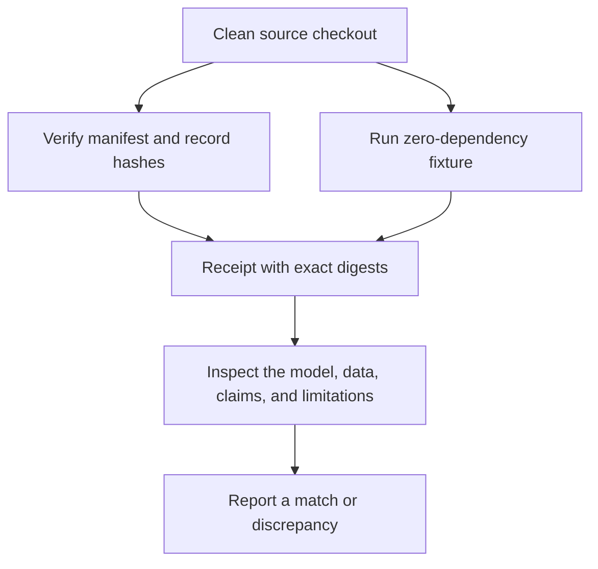

# Independent review

## Reviewing annotations while researching

Annotation review is optional. Search, first-pass analysis, vocabulary exploration,
and provisional exports do not require approval. Review the fields that support
your research claim; also sample unflagged material, since a low-risk flag does
not establish correctness.

```bash
aegean review export corpus.json -o review.csv --selection unverified --reviewer Alice
# Fill field decisions in the CSV, then apply them to the same corpus.
aegean review apply corpus.json review.csv -o reviewed.json
```

Use `--selection all` for every word or `--selection flagged` for the existing
review flag. `unverified` specifically checks lemma verification, not every
annotation field. To generate predictions first, add `--annotate` and any backend
flags, such as `--neural`, to export, merge, and apply. The generated apply command
preserves those flags and quotes paths for a POSIX shell.

Set `decision_lemma`, `decision_pos`, or `decision_morph` independently:

| Decision | What to enter | Result |
| --- | --- | --- |
| `accept` | Leave the corresponding `correct_*` cell blank. | Verify the unchanged, existing prediction for this field. |
| `correct` | Enter a different, nonempty value in `correct_*`. | Save and verify the correction while preserving the original prediction. |
| `defer` | Leave `correct_*` blank. | Retain the prediction and mark this field unverified for later work. |
| `reject` | Leave `correct_*` blank. | Retain the rejected prediction as evidence and mark this field unverified; no replacement is inferred. |
| Blank | Optionally enter a correction. | Preserve the older correction-only behavior; an unchanged value or blank row conveys no approval. |

`reviewer` identifies the scholar; `reviewer_note` records the reason; and
`reviewer_evidence` accepts a citation, URL, or other evidence reference. A blank
identity falls back to `review apply --reviewer`, then to `anonymous`. Notes and
evidence apply only to fields with a decision or an actual legacy correction.
Accepting a lemma does not verify POS, morphology, dependencies, or lexical sense.

The saved corpus keeps per-field decisions and verification, the first prediction
under `<field>__pred`, and a structured `review_history` with every action,
prediction, value, reviewer, note, evidence, source class, and date. Reannotation
invalidates the current decisions for fields it replaces while retaining history;
export a new table to reconsider them. Applying explicit decisions from a table
whose prediction or source alignment changed raises an error.

CSV snapshot checks compare displayed values, lemma source classes, and exact
source/form alignment. They do not independently identify a model version or
certify that two runs used the same model artifact. Reannotation marks current
decisions stale even when the new values agree; use a fresh export when reviewing
the replacement analysis. A separate model revision yielding identical values
and source classes cannot be distinguished from the CSV alone.

Several scholars can review copies of the same export, then run
`aegean review merge alice.csv bob.csv --corpus corpus.json -o merged.csv`.
Conflicting actions or corrections remain unresolved; `--on-conflict report`
writes only the agreed subset. A merged CSV's read-only `reviewer_records` column
preserves each person's field attribution, note, and evidence, including when
different people checked different fields. Keep source, alignment, prediction,
and merge-attribution columns intact.

## Reproducing the public evidence

pyaegean includes a one-command review path for people who want to check the
public evidence before reading the rest of the repository:

```bash
git clone https://github.com/ryanpavlicek/pyaegean.git
cd pyaegean
python scripts/reproduce_review.py
```

The command runs on CPython 3.10 through 3.14. It uses the standard library and
the checked-out zero-dependency source. It verifies a canonical SHA-256 manifest
whose records each choose byte-exact or cross-platform canonical-LF hashing, runs
the project-authored offline regression fixture and one baseline Greek sentence,
and compares the result byte-for-byte with the reviewed expectation. When Git is
available, it also reports the commit and whether the checkout is clean.

It does not download or run the neural model, use the network, write bytecode, or
create a pyaegean cache. The fixture result is not a neural accuracy claim:
reproducing the published neural rows needs the complete pinned protocol on the
[Benchmarks](benchmarks.md) page.



## Reading the receipt

A pass establishes two things:

1. Every public record in the review manifest has the reviewed bytes.
2. The deterministic offline journey gives the reviewed result on this interpreter.

A pass does not certify the scholarly interpretation of a source, rerun a large
model, or amount to outside peer review. `--json` prints the complete
machine-readable receipt. `--allow-dirty` is available for local diagnosis, but a
dirty run is not clean reproduction evidence.

## What to inspect next

The repository's [independent review kit](https://github.com/ryanpavlicek/pyaegean/tree/main/review)
contains the canonical manifest, a model card, a data card, an evidence map, a
limitations matrix, and the discrepancy-report path. The measured-value registry is
[`training/results/published-claims.json`](https://github.com/ryanpavlicek/pyaegean/blob/main/training/results/published-claims.json),
and this site's [Methodology](methodology.md) page explains the data, architecture,
evaluation, and review rules in full.

The model card identifies the shipped artifact and its intended use. The data card
describes training and evaluation roles, separation, licenses, and coverage limits.
The wiki's [Validation and review](https://github.com/ryanpavlicek/pyaegean/wiki/Validation-and-Review)
page states what has and has not had outside review, and
[Limitations](https://github.com/ryanpavlicek/pyaegean/wiki/Limitations) keeps the
full boundary register.

## Reporting a mismatch

Open an [independent-review discrepancy](https://github.com/ryanpavlicek/pyaegean/issues/new?template=reproduction_discrepancy.yml)
with the exact command, package version, Git commit or source-archive hash, manifest
SHA-256, deterministic-result SHA-256, environment, observed output, and all local
modifications. Record a discrepancy exactly; it is useful evidence.

Prospective maintainers can start with the ownership slices in
[`CONTRIBUTING.md`](https://github.com/ryanpavlicek/pyaegean/blob/main/CONTRIBUTING.md).
