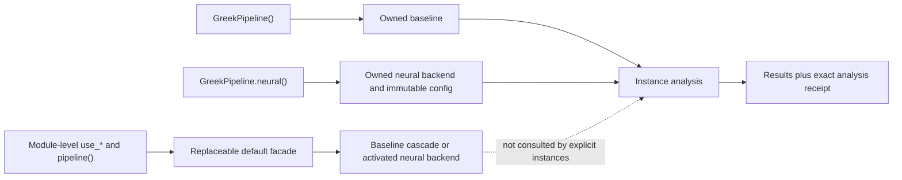

# Greek NLP

`aegean.greek` provides pyaegean's Ancient Greek NLP pipeline: Beta Code
conversion, Unicode normalization, tokenization, syllabification, accentuation,
metrical scansion, phonology, POS tagging, morphology, lemmatization, dependency
parsing, dictionary glossing, and work loaders.

Every stage is an independent function that can be called directly or chained
through `pipeline()`. The core package runs offline with zero third-party
dependencies and no API key. Opt-in treebank, lexicon, pure-Python ML, and
neural backends fetch their data assets to your local cache on first use.

Each operation has both a Python API (`from aegean import greek`) and a matching
CLI subcommand (`aegean greek …`, installed via `pip install "pyaegean[cli]"`),
with `--json` available on every CLI command. Biblical and Koine Greek corpus
and lexicon tools live under `aegean.greek.bible` and `aegean bible …` (see
[New Testament](New-Testament)).

```python
from aegean import greek
```

Generated facade signatures and docstrings are published in the
[Greek API reference](https://pyaegean.xyz/api/greek/); this page covers
behavioral contracts, configuration, and source-evidence semantics. See
[CLI](CLI) for shell tooling, [Getting Started](Getting-Started) for first
steps, [Meters](Meters) for metrical scansion, and
[Greek Works and Books](Greek-Works-and-Books) for corpus loaders.

> **Scope and benchmarks.** The zero-dependency core prioritizes portability,
> fast import time, reproducible evaluation, metrical scansion, and corpus I/O.
> The opt-in **[neural pipeline](#the-neural-pipeline-opt-in)**
> (`use_neural_pipeline`, `[neural]` extra) is evaluated end-to-end on UD
> Ancient Greek (Perseus); full protocols, measured rows, comparisons, and
> caveats live in [Benchmarks](Benchmarks).

## Pipeline stages

Each stage is callable independently and mirrored in the CLI. Opt-in backends
upgrade accuracy behind the same function calls.

| Stage | Python | CLI | Network? |
| --- | --- | --- | --- |
| Beta Code ↔ Unicode | `betacode_to_unicode` / `unicode_to_betacode` | `aegean greek betacode` | no |
| Normalize (NFC, OCR repair) | `normalize` | `aegean greek normalize` | no |
| Strip diacritics | `strip_diacritics` | `aegean greek strip` | no |
| Tokenize / sentences | `tokenize` / `tokenize_aligned` / `tokenize_words` / `sentences` / `segment_text` / `segment_sentences` | `aegean greek tokenize` | no |
| Syllabify | `syllabify` | `aegean greek syllabify` | no |
| Accent analysis | `accentuation` | `aegean greek accent` | no |
| Accent placement | `place_accent` / `recessive_accent` / `persistent_accent` | `aegean greek accentuate` | no |
| Resolve sandhi | `resolve_sandhi` / `resolve_sentence` | `aegean greek sandhi` | no |
| Prosody (quantities) | `syllable_quantities` / `scan` | `aegean greek quantities` | no |
| Metrical scansion | `scan_hexameter` / `scan_line` / … | `aegean greek scan` | no |
| Reconstructed IPA | `to_ipa` | `aegean greek ipa` | no |
| POS tag | `pos_tag` / `pos_tags` | `aegean greek tag` | opt-in backends |
| Lemmatize | `lemmatize` | `aegean greek lemmatize` | opt-in backends |
| Morphology | `analyze` / `lemmas` / `best_pos` | `aegean greek morph` | opt-in treebank |
| Inflection synthesis | `inflect` / `paradigm` | `aegean greek inflect` | opt-in treebank |
| Dependency parse | `parse` | `aegean greek parse` | opt-in backends |
| LSJ gloss | `gloss` / `lookup` | `aegean greek gloss` | yes (first use) |
| Dialect / register | `usage` | `aegean greek usage` | yes (LSJ) |
| Terminology rarity | `terminology_rarity` | `aegean greek rarity` | reference corpus |
| Koine / Strong's gloss | `bible.strongs_entry` / `bible.word_study` | `aegean bible strongs` | no (bundled Dodson; extended on demand) |
| One-call pipeline | `pipeline` | `aegean greek pipeline` | opt-in backends |
| Load a classical work | `load_work` | `aegean greek work` | yes (first use) |
| Load Biblical Greek (NT / LXX) | `bible.load_nt` / `bible.load_lxx` | `aegean bible read` | no for bundled samples; yes for full corpora |
| Discover works / books | `popular_works` / `catalog` / `bible.nt_books` / `bible.lxx_books` | `aegean greek works` / `catalog` / `aegean bible books` | no |
| Import your own text | `io.from_text` / `from_text_file` / `from_csv` / … | `aegean import` | no |
| Reproduce benchmarks | `evaluate_on_ud` / `evaluate_on_proiel` / … | `aegean greek eval` | yes (gold data) |

## One call: `pipeline()`

> **Available in v0.72.0.** Isolated pipeline instances, explicit long-input and
> runtime-variant selection, analysis receipts, source alignment, typed editorial
> form states, and lossless CoNLL-U representation are part of the current
> release.

`pipeline()` chains tokenization, sentence splitting, POS tagging,
lemmatization, and optional dependency parsing in one call, returning one
`TokenRecord` per token (punctuation retained). Pass `sentence_policy="prose"`,
`"verse"`, `"inscription"`, or `"papyrus"` for genre-specific boundary rules, or
supply `segmenter=` with a custom segmenter. Segmentation runs per call before
sentence word lists reach the active backend:

```python
records = greek.pipeline("ἐν ἀρχῇ ἦν ὁ λόγος.")
[(r.text, r.upos, r.lemma) for r in records]
# [('ἐν','ADP','ἐν'), ('ἀρχῇ','NOUN','ἀρχή'), ('ἦν','VERB','εἰμί'),
#  ('ὁ','DET','ὁ'), ('λόγος','NOUN','λόγος'), ('.','PUNCT','.')]
```

From the shell (`--json` emits the structured records):

```bash
aegean greek pipeline "ἐν ἀρχῇ ἦν ὁ λόγος."
#  s   i   token   upos    lemma   src   head   rel   feats
#  0   1   ἐν      ADP     ἐν
#  0   2   ἀρχῇ    NOUN    ἀρχή
#  0   3   ἦν      VERB    εἰμί
#  0   4   ὁ       DET     ὁ
#  0   5   λόγος   NOUN    λόγος
#  0   6   .       PUNCT   .
```

The `src` column flags identity fall-throughs and unresolved misses; a blank
cell indicates a resolved lemma, not a verified one. `head`, `rel`, and `feats`
populate when a parsing or neural backend is active.

Each `TokenRecord` exposes these fields:

| Field | Meaning |
| --- | --- |
| `sentence` | 0-based sentence index |
| `index` | 1-based token index within the sentence |
| `text` | surface token (punctuation included) |
| `upos` | UD coarse part of speech |
| `lemma` | predicted or resolved lemma |
| `lemma_source` | lemma provenance: `attested`, `neural_lookup`, `neural_edit`, generic `neural`, `rule`, `seed`, `paradigm`, `identity`, `unresolved`, `punct`, or human-corrected `user` |
| `lemma_source_path` | neural composition route: `lookup_form_upos`, `lookup_form`, `edit_script`, `lookup_lower_fallback`, or `identity_fallback` (when typed neural confidence is requested) |
| `lemma_resolved` | whether a lemma decision was made rather than a surface fallback |
| `lemma_verified` | whether an imported human lemma correction is recorded (`user`) |
| `review_recommended` | whether `lemma_source` is `identity` or `unresolved` (not a general error detector) |
| `lemma_known` | deprecated compatibility alias for `lemma_resolved` |
| `head` | syntactic head token index (when parsed) |
| `relation` | dependency relation (when parsed) |
| `xpos` | language-specific tag (neural pipeline only) |
| `feats` | UD FEATS string (neural pipeline only) |
| `upos_confidence`, `lemma_confidence` | legacy flat confidence floats retained for compatibility (not source- or domain-scoped) |
| `token_confidence` | typed per-task confidence records (`upos`, `xpos`, `feats`, `lemma`, `head`, `relation`) with calibrated values or explicit unavailable reasons |
| `sentence_confidence` | typed sentence-level aggregate, component names, evidence scope, and optional policy decision |
| `neural_analyzed` | per-token neural coverage (`False` only for partial-mode placeholders; `None` offline) |
| `analysis_complete`, `analysis_warning` | sentence-level neural coverage flag and any partial-mode warning |
| `analysis_receipt` | model, asset, manifest, runtime, provider, profile, and preprocessing receipt |
| `alignment` | original text slice, source IDs, Unicode code-point span, preceding whitespace, and normalization operations |
| `form_state` | typed diplomatic, regularized, normalized, and model-input forms for pre-tokenized corpus input |
| `boundary_policy`, `boundary_policy_id` | named segmentation policy and stable ID ending this sentence (on the terminal token) |
| `boundary_provenance`, `boundary_confidence` | `rule`, `explicit`, or `plugin`; built-in rules carry no confidence, while plugins may attach a finite `[0, 1]` value |
| `boundary_start_char`, `boundary_end_char` | half-open source span for the sentence boundary when alignment proves it |

UD feature labels reflect the supplying treebank convention. `Tense=Past` alone
does not distinguish Greek tense/aspect or event time, and `Aspect=Perf`
depends on the scheme (Perseus uses it for Greek perfect forms). Subjunctives,
infinitives, and participles do not establish past time from a past-tagged form.
The hybrid translator keeps raw FEATS alongside readable morphology and labels
clause summaries as predicted: it lists supplied subordinate predicates and
coordinated subjects, marks omissions, and does not infer missing subject
attachments. See [Translation](Translation#the-grounding-what-the-model-is-told).

`TokenRecord.lemma_verified` reflects an imported human correction (`user`).
A separate corpus review can accept a predicted lemma while retaining its
original prediction source in per-field review annotations. Neither certifies
POS, morphology, syntax, or lexical sense. See
[Validation and Review](Validation-and-Review).

### Exact source alignment

Every `pipeline()` record carries an immutable `SourceAlignment`. `start_char`
and `end_char` are half-open Python Unicode code-point offsets into the exact
input string (not UTF-8 bytes and not offsets into normalized text).
`original_text` stores the exact slice, `normalized_text` holds the NFC string
fed to the neural path, and `normalization_ops` records `unicode:nfc` only when
normalization changed the text. Decomposed accents, Greek punctuation, and
numeral signs remain traceable even when the model sees an NFC form.

```python
text = "  α\u0301\tλόγος."
records = greek.pipeline(text, document_id="example")
a = records[0].alignment

(a.original_text, a.normalized_text, a.start_char, a.end_char)
# ('ά', 'ά', 2, 4)
text[a.start_char:a.end_char] == a.original_text       # True
a.whitespace_before                                   # '  '
a.normalization_ops                                   # ('unicode:nfc',)
```

`document_id` defaults to `"input"`; pass a stable identifier for export or
review workflows. `sentence_id` is stable for unchanged segmentation, and
`source_token_id` is deterministic for the same document ID and source snapshot.
Analyses map back by token ordinal so repeated tokens and NFC-equivalent
spellings cannot collide. JSON CLI, MCP, and TUI outputs flatten these values
into `alignment_*` fields. Each sentence's terminal token also carries the
`boundary_*` metadata fields.

For alignment without running analysis, `greek.tokenize_aligned(text,
document_id=...)` returns `Token` objects carrying the same spans; `tokenize()`
and `sentences()` keep their original shapes. `Token.alignment` and
`Document.source_text` persist in schema-2 JSON and SQLite (schema-1 files load
with those fields absent), and `Token.form_state` persists in schema-3 JSON and
SQLite. Editorial damage/restoration state remains distinct from Unicode
normalization.

### Editorial form state and the analyzer input

Pre-tokenized input can attach a `TokenFormState` beside the display
`Token.text`: `diplomatic` holds the original source spelling, `regularized`
holds an editorial correction or expansion, and `normalized` holds an optional
preprocessing form. `model_input` records the exact string passed to the
analyzer, alongside `model_input_source` and `model_input_ops`. These fields
are kept distinct so a computed analyzer input is never mistaken for an
editorial reading.

`greek.pipeline_tokens(tokens)` selects an explicit `model_input` first, then
`regularized`, `normalized`, `diplomatic`, and finally `Token.text`, recording
the choice on `TokenRecord.form_state` (and appending `unicode:nfc` when the
neural path normalizes the string). `greek.pipeline(text)` tokenizes raw strings
and produces no typed editorial form state unless pre-tokenized tokens are
passed through `pipeline_tokens()`.

### Sentence segmentation: named policies and an extension seam

`greek.segment_text(text)` (aliased as `segment_sentences()`) returns an
immutable `SegmentationResult` containing the exact source string, ordered
`SentenceBoundary` spans, `policy`, `policy_id`, and `provenance`. Each
boundary is a half-open Python code-point span `(start, end)` whose slice
retains terminal punctuation and closing marks. `greek.sentences(text)` keeps
its legacy trimmed-string projection with terminal marks removed.
`SegmentationResult` serializes strictly via `to_json()` and
`SegmentationResult.from_json()`.

`RuleBasedSentenceSegmenter` ships five named policies (described in
`greek.POLICY_RULES`, with stable IDs in `greek.POLICY_IDS` alongside a sixth
reserved `explicit` ID for caller-supplied boundaries):

| Policy | Rule |
| --- | --- |
| `default` | Conservative period, semicolon/Greek question mark, ano teleia/middle dot, `!`, and `?`; protects dotted abbreviations and numerals. |
| `prose` | Same conservative punctuation rules, named for literary prose. |
| `verse` | Prose punctuation rules plus every non-empty physical line as a boundary. |
| `inscription` | Strong `.`, `!`, and `?` only; semicolon and ano teleia stay uncommitted. |
| `papyrus` | Strong `.`, `!`, and `?`; punctuation inside balanced `[]`, `⟦⟧`, or `<>` editorial brackets is ignored. |

Built-in rules are deterministic and carry no confidence score. Extend protected
abbreviations with `RuleBasedSentenceSegmenter(policy="prose",
abbreviations=["sig."])`. Custom plugins implement `segment(text)` (or a plain
callable) returning a `SegmentationResult`, boundary dicts, or `(start, end)`
tuples. `segment_text(..., segmenter=plugin)` validates every boundary,
rejecting unknown keys, out-of-range or overlapping spans, uncovered
non-whitespace text, policy mismatches, and (during tokenization) boundaries
that split a token. Plugin results are tagged `provenance="plugin"` and cannot
claim a reserved built-in policy ID; optional plugin confidence is metadata in
`[0, 1]`, not a measured accuracy claim.

For `pipeline_tokens()`, complete contiguous runs of
`Token.alignment.sentence_id` take precedence over punctuation,
`sentence_policy`, and plugins; partial, non-contiguous, or cross-document
sentence IDs are rejected. When sentence IDs are absent, the chosen policy runs
over the typed token stream, ignoring editorial punctuation marked `UNCLEAR`,
`RESTORED`, or `LOST`. Word-final terminal punctuation inside a `WORD` token
also terminates the sentence:

```python
from aegean import Token, TokenKind

tokens = [Token(text=t, kind=TokenKind.WORD) for t in ("λόγος.", "καὶ", "θεός.", "ἦν")]
[(r.sentence, r.index, r.text) for r in greek.pipeline_tokens(tokens)]
# [(0, 1, 'λόγος.'), (1, 1, 'καὶ'), (1, 2, 'θεός.'), (2, 1, 'ἦν')]
```

### Lossless CoNLL-U structure and the model projection

`greek.load_conllu_document(path)` retains complete CoNLL-U files: ordered
comments, all ten columns, multiword-token ranges, empty decimal nodes
(including `0.1`), enhanced `DEPS`, `MISC`, row order, and original line
endings. Each sentence exposes two aligned views:

- `sentence.rows`: complete ordered row stream.
- `sentence.tokens`: integer-ID syntactic words matching the `UDSentence`
  training and evaluation contract.
- `sentence.items`: interleaved comments and rows for structural inspection.
- `sentence.projection`: mapping from model ordinals to original integer IDs,
  omitted range and empty-node IDs, and enhanced-dependency presence flags.

Word rows may store typed editorial form state in the reserved
`AegeanFormState` MISC key (URL-safe base64 JSON, schema 1), decoded into
`UDToken.form_state` while leaving other MISC entries untouched. `strict=True`
rejects malformed, duplicate, unknown-schema, or oversized entries as well as
broken columns, IDs, or basic trees with line-aware errors; lenient loading
(the default for legacy research folds) preserves the raw MISC entry without
decoding a typed state.

```python
from aegean import greek

document = greek.load_conllu_document("treebank.conllu", strict=True)
sentence = document.sentences[0]

sentence.projection.ordinal_to_id
sentence.projection.omitted_empty_nodes
greek.write_conllu(document, "treebank-copy.conllu")
```

Unchanged documents round-trip verbatim; `canonical=True` emits deterministic
ten-column output after edits while preserving extension comments (`# text_en =
…`, `# sent_id_orig = …`). The CLI exposes this through
`aegean greek conllu inspect` and `aegean greek conllu export`.

This is a lossless representation layer only: the shipped `grc-joint-v3` model
still analyzes and predicts syntactic words alone, and does not generate
multiword rows, empty nodes, or enhanced arcs. Preserved gold annotations are
never copied into system output or scores, and the model's CoNLL-U projection
does not emit `AegeanFormState` (serialize stateful `UDToken` records directly
with `greek.dump_conllu()` or `greek.write_conllu()`). Callers requiring full
structural prediction can select the strict error policy instead of accepting
the syntactic-word projection.

For a field-by-field guide to interpreting `TokenRecord` and `lemma_source`,
see [Reading a Parse](Reading-a-Parse).

For interop with external NLP libraries, `aegean.io` provides `from_conllu()` /
`to_conllu()` (retaining the full row stream) and `to_spacy()` / `from_spacy()`,
`to_stanza()` / `from_stanza()`, and `to_cltk()` / `from_cltk()` (populating
native framework fields and storing remaining metadata in a SHA-256-bound
`aegean.interop/v1` sidecar that detects stale or mismatched data without
acting as a cryptographic signature). See [Interoperability](Interoperability).

`pipeline()` dispatches to whichever backends are active: the zero-dependency
baseline by default, upgraded by `use_treebank()` / `use_tagger()` /
`use_lemmatizer()` / `use_parser()`, or replaced in one pass by
`use_neural_pipeline()`. Calling `pipeline(..., parse=True)` (CLI `--parse`)
without the neural backend requires `use_parser()` (CLI `--parser`). On the
CLI, `--treebank`, `--tagger`, `--lemmatizer`, `--neural-lemmatizer`, and
`--neural` activate the corresponding backend for that invocation. See
[Choosing a Pipeline](Choosing-a-Pipeline) for choosing a configuration by
genre and task.

## The neural pipeline (opt-in)

Activate the joint model with `greek.use_neural_pipeline()` and call
`greek.pipeline(...)` or `greek.analyze_sentence(...)`.

The shipped model (`grc-joint-v3`) combines a GreBerta encoder, tagging heads,
a biaffine dependency parser with single-root MST decoding (handling
non-projective trees natively), and an edit-script lemmatizer to produce
**UPOS, UD FEATS, dependency trees, and lemmas** in a single forward pass. It
is trained leakage-clean on AGDT + Gorman + Pedalion (1.41M tokens, excluding
all sentences overlapping the evaluation folds).

```bash
pip install "pyaegean[neural]"     # onnxruntime + tokenizers + numpy; no torch
# or pyaegean[all], which includes the neural runtime (model fetch stays lazy)
```

```python
greek.use_neural_pipeline()        # fetches the model bundle (~173 MB, one-time) to the cache

ana = greek.analyze_sentence(["ἐν", "ἀρχῇ", "ἦν", "ὁ", "λόγος"])
list(zip(ana.tokens, ana.upos, ana.deprel, ana.lemma))
# [('ἐν','ADP','case','ἐν'), ('ἀρχῇ','NOUN','root','ἀρχή'), ('ἦν','VERB','cop','εἰμί'),
#  ('ὁ','DET','det','ὁ'), ('λόγος','NOUN','nsubj','λόγος')]
ana.feats[1]                       # 'Case=Dat|Gender=Fem|Number=Sing'
```

### Runtime variants: what the names mean

Runtime variants identify packaged neural artifacts rather than analysis modes.
Four stable labels exist:

| Label | Status | Qualification rule |
| --- | --- | --- |
| `default` | Available (`grc-joint-v3`) | Release-selected artifact; the label carries no speed or size guarantee. |
| `fast` | Reserved, unavailable | Requires repeated same-environment CPU measurements meeting the frozen latency rule. |
| `compact` | Reserved, unavailable | Requires a qualified artifact at most 90% the size of its reference. |
| `balanced` | Reserved, unavailable | Optional; requires the compact size rule plus frozen latency and peak-memory bounds. |

Labels are never inferred from filenames or ONNX precision. Requesting a
reserved label raises immediately before checking optional dependencies,
downloading, or touching the cache, and never falls back to `default`. Omitting
`variant=` is identical to `variant="default"`:

```python
greek.neural_variants()                         # inspect all four stable labels
greek.neural_variants(available_only=True)      # currently: default only

greek.use_neural_pipeline(variant="default")
owned = greek.GreekPipeline.neural(variant="default")
```

Distinct artifacts use separate cache keys, so `force=True` refreshes only the
selected variant. `GreekPipelineConfig` schema 2 records the label, registry
digest, artifact manifest, and any qualification digests; `AnalysisReceipt`
schema 4 binds the same selection provenance together with the live runtime
environment. `GreekPipeline.from_config()` rejects registry drift or
unavailable labels before loading. On the CLI, pass `--neural-variant LABEL`
with `--neural`; translation accepts `--greek-backend neural --greek-variant
LABEL`.

The module-level helpers are a convenience facade over
`greek.default_pipeline()`. Applications needing concurrent or isolated
configurations can instantiate `GreekPipeline` objects directly:

| Name | Behavior | Side effects |
| --- | --- | --- |
| `greek.pipeline(text)` | Analyzes text immediately | None; reads the module-level default facade |
| `greek.use_neural_pipeline()` | Activates the neural backend on the module-level facade | Affects subsequent module-level POS, lemma, parse, and `pipeline` calls |
| `greek.GreekPipeline.neural()` | Constructs an isolated neural pipeline instance | None outside that instance; call `instance.analyze(text)` |

Lowercase `pipeline(...)` runs analysis, `use_neural_pipeline()` switches the
module-level default backend, and `GreekPipeline` is an independently owned
instance.

The hybrid translator follows the same pattern: omit `greek_pipeline=` in
`translate()` to use the module default, or pass a `GreekPipeline` instance
for isolation. From the shell, pass `--greek-backend default|baseline|neural`
(plus `--greek-variant` when `neural` is selected) and `--greek-long-input` for
long-sentence handling. Translation provenance records the backend config and
long-input mode separately from the linguistic grounding sent to the LLM.
Translation currently uses the pipeline's default sentence policy. See
[Translation](Translation#which-greek-backend-supplies-the-grounding).

```python
literary = greek.GreekPipeline.neural()  # loads without changing the default facade
baseline = greek.GreekPipeline()         # isolated zero-dependency baseline

literary.analyze("ἐν ἀρχῇ ἦν ὁ λόγος.")
baseline.analyze("ἐν ἀρχῇ ἦν ὁ λόγος.")

config_json = literary.config.to_json()
config = greek.GreekPipelineConfig.from_json(config_json)
same_runtime = greek.GreekPipeline.from_config(config)
```

Each instance owns its model session, tokenizer, annotation profile,
normalization, backend segmentation contract (`pretokenized` for
`grc-joint-v3`, distinct from document-level `sentence_policy`), and execution
provider list. Instance calls are context-local, so concurrent pipelines never
interfere with one another or with module-level state. `GreekPipelineConfig`
captures immutable configuration identity, while `AnalysisReceipt` records
per-run package versions, asset digests, input coverage, and runtime details.
Because each neural instance loads its own ONNX session, reuse shared
instances where practical.



Neural input length is strict by default: if a pre-tokenized sentence exceeds
the bundle's subword limit, `analyze_sentence()` raises
`NeuralInputTooLongError`. Split long text at true sentence boundaries when
possible, or select an explicit long-input mode:

- `long_input="partial"` analyzes the fitting prefix and marks uncovered tail
  tokens as placeholders. Use this for inspection only, not as a complete parse.
- `long_input="windowed"` runs overlapping whole-word windows across the
  sentence. Each token's tags, lemma edit script, and typed confidence come
  from the window in which it sits farthest from a window edge; candidate arcs
  from each token's owner window are mapped to sentence indices and decoded
  once into a global single-root tree. The result emits a warning noting that
  distant token pairs never sharing a window were not arc candidates, and sets
  `receipt.windowed = True`.

Both modes retain every input token and expose coverage explicitly:

```python
greek.use_neural_pipeline()

ana = greek.analyze_sentence(words, long_input="partial")
ana.complete, ana.truncated             # (False, True) when the limit was reached
ana.analyzed                            # one bool per token
ana.warnings                            # explains that uncovered values are placeholders

records = greek.pipeline(text, long_input="partial")
records[-1].neural_analyzed             # False for an uncovered token
records[-1].analysis_complete           # sentence-level status

long_ana = greek.analyze_sentence(long_words, long_input="windowed")
long_ana.complete, long_ana.truncated   # (True, False) when all windows reconcile
long_ana.receipt.windowed               # True when multiple windows were used
```

Windows align to whole words without splitting tokens. Overlap targets the
lesser of 64 body subwords or one quarter of the model's body budget (retaining
a single longer token to preserve overlap), and input that cannot retain at
least one overlapping token with forward progress is rejected. To bound dense
global MST decoding, windowed input is capped at 4,096 tokens and 1,000,000
characters. Sentences that fit in a single pass run through the ordinary path
unchanged and do not set `receipt.windowed`. Both `partial` and `windowed`
require an active neural backend and raise on the baseline pipeline.

The subword limit comes from the validated bundle contract. Activation verifies
the manifest, every listed file's size and SHA-256, tokenizer revision and
special-token settings, label maps, lemma tables, output heads, and schema
compatibility before enabling the model. Because the frozen v3 archive predates
versioned manifests, it is accepted solely via its exact published-file
compatibility record; any different unversioned archive must ship under a new
model ID and schema.

Every production `SentenceAnalysis` attaches a canonical, serializable
`AnalysisReceipt` recording:

- model ID, asset and manifest SHA-256 digests, and bundle schema;
- tokenizer revision;
- package, Python, and ONNX Runtime / NumPy / tokenizers versions;
- active execution providers;
- inference annotation profile;
- normalization and model-input segmentation contract;
- length limit and truncation or windowing status.

Receipt schema 4 also binds the runtime variant label, variant registry digest,
qualification/award digests when present, composed output profile, and ordered
post-processing chain. Schemas 1–3 remain readable for existing hosted evidence
without inventing absent variant fields. `receipt.to_json()` is canonical and
`receipt.sha256` content-addresses it. Passing a prior receipt to
`use_neural_pipeline(expected_receipt=receipt)` fails fast on any runtime or
artifact mismatch.

Lemma provenance is tracked on every token: joint-model lookups emit
`LemmaSource.NEURAL_LOOKUP`, non-identity edit scripts emit `NEURAL_EDIT`, and
surface fallbacks emit `IDENTITY`. `TokenRecord.lemma_resolved` indicates
whether a real lemma decision occurred, `lemma_verified` is `True` only for an
imported human correction, and `review_recommended` flags `identity` and
`unresolved` tokens (not general prediction errors). The deprecated
`lemma_known` property aliases `lemma_resolved`.

Once the neural pipeline is active, `pos_tags`/`pos_tag`, `lemmatize`, and
`parse` route through it, with `parse()` emitting **UD relations** (`nsubj`,
`obj`, `advcl`, …) and 9-character XPOS tags. Call `disable_neural_pipeline()`
to return to the baseline cascade. From the CLI, pass `--neural` (optionally
with `--neural-variant LABEL`) to `tag`, `lemmatize`, `parse`, or `pipeline`.
Evaluation commands always evaluate the release-selected default and do not
accept `--neural-variant`.

**Measured: UD Ancient Greek test folds, official CoNLL 2018 evaluator, through
the shipped package, gold tokenization:**

| UD Perseus test | UPOS | UFeats | Lemma | UAS | LAS |
| --- | --- | --- | --- | --- | --- |
| neural pipeline | **97.0** | **96.0** | **94.3** | **90.2** | **85.7** |

Evaluated end-to-end from raw text, pyaegean's tokenizer reaches tokens F1
99.97 on Perseus and overall scores track the gold-tokenized figures closely.

Out of domain on UD PROIEL test (never used in training): lemma 90.51, UAS
82.47, UPOS 86.68. CPU inference runs without PyTorch at roughly
**20–70 words/s** for the shipped quantized `grc-joint-v3` bundle (depending on
sentence length); the full-precision `grc-joint-v2` reference asset is faster
on CPU when download size is less important than throughput. The quantized v3
archive is ~173 MB (versus 518 MB for fp32) with no measured accuracy drop,
using weight-only int8 (`onnxruntime` `MatMulNBits`) plus fp16 while keeping
activations in fp32. It requires **`onnxruntime >= 1.23`** (the `[neural]`
floor). The bundle is CC BY-SA 4.0, fetched to cache on demand, and never
bundled; training data, leakage controls, and comparison tables are in
[Benchmarks](Benchmarks).

### Confidence, scope, and abstention (opt-in)

Pass `with_confidence=True` to `greek.pipeline()` or `GreekPipeline.analyze()`
to populate calibrated `token_confidence` and `sentence_confidence` fields.
Each `ConfidenceResult` records task, model, source path, optional domain,
calibration hash, sample count, measured ECE and Brier score, and either a
probability in `[0, 1]` or an explicit unavailable reason (`missing_calibration`,
`unsupported_task`, `unsupported_source`, `unsupported_domain`,
`no_threshold_for_task`, or `confidence_unavailable`). Missing confidence is
never coerced to zero.

The legacy `upos_confidence` and `lemma_confidence` floats remain for backward
compatibility only and carry no source or domain scope. For scoped calibration,
call `greek.use_calibration_registry()` with no arguments to load the bundled
Schema-2 `CalibrationRegistry` (`calibration_registry_v2.json`, covering
`literary` and `documentary_native` across all six tasks and all four lemma
routes), or pass a custom registry path, then pass
`confidence_domain="literary"` or `"documentary_native"`. The legacy
`use_calibration()` aggregate remains available as an explicitly unscoped
fallback. Lookup prefers exact model/task/source/domain matches and flags any
broader entry as a fallback. Offline lexicon, rule, seed, and paradigm lemmas
never borrow neural confidence. `lemma_source_path` records the exact
composition route (`lookup_form_upos`, `lookup_form`, `edit_script`,
`lookup_lower_fallback`, or `identity_fallback`).

Development fitting utilities `fit_temperature(logits, correct)` and
`fit_logit_affine(probs, correct)` fit scalar temperature or monotone
`sigmoid(slope * logit(p) + intercept)` parameters on caller-supplied dev
pairs; calling them does not validate a domain or choose an abstention
threshold.

Abstention policies are caller-owned. Pass an immutable `AbstentionPolicy` via
`confidence_policy=` with per-task thresholds; each decision is `accept`,
`review`, or `unavailable` and records `policy_sha256`. The CLI exposes
`--confidence-domain` and `--confidence-policy PATH` on `aegean greek pipeline`.
No default abstention threshold or automatic OOD detector is bundled; for
editorial triage, sort review exports with `priority="calibrated_risk",
budget=N`. Schema-4 `AnalysisReceipt` output binds runtime-variant identity,
calibration and policy hashes, and the composed output profile; schemas 1–3
remain readable for older outputs.

### Opt-in weighted OOV lemma reranking

For texts containing poetic, dialectal, or documentary spellings unseen during
training, enable the bundled OOV lemma reranker on top of the neural pipeline:

```python
greek.use_neural_pipeline()
greek.use_oov_lemma_reranker(config="weighted")   # opt-in; zero overhead when inactive
# ... analyze texts ...
greek.disable_oov_lemma_reranker()
```

For out-of-vocabulary forms, the reranker combines the joint model's top-10
edit-script predictions with train-only orthographic, Koine phonetic, and
preverb-stripped candidates using frozen dev-fitted weights with no external
dictionary leakage (+0.69 pp on UD Perseus, +0.96 pp on UD PROIEL/NT, +1.50 pp
on tragedy, +2.03 pp on regularized papyri, and +3.43 pp on diplomatic papyri
across the five locked test folds; see [Benchmarks](Benchmarks)). Pass
`config="unique"` for the conservative unique-match fallback.

### GPU execution and batching

When a GPU build of ONNX Runtime is installed, provider selection prefers CUDA,
then DirectML, keeping CPU as fallback. Set `PYAEGEAN_ORT_PROVIDERS` (e.g.
`CUDAExecutionProvider,CPUExecutionProvider`) to specify exact providers;
requesting an unavailable provider raises an error listing installed providers.
Inspect live providers with `greek.neural_backend_info()`.

```bash
pip uninstall onnxruntime && pip install onnxruntime-gpu   # NVIDIA CUDA
# Match the wheel to your CUDA version: on CUDA 12 use onnxruntime-gpu==1.25.*
# (current PyPI onnxruntime-gpu targets CUDA 13). DirectML: onnxruntime-directml.
```

For streaming over generators, cursors, or large files without materializing
all results in memory, use `iter_analyze_sentences()`:

```python
greek.use_neural_pipeline()
for analysis in greek.iter_analyze_sentences(sentence_source(), batch_size=32):
    save(analysis)  # source order; each result carries its own AnalysisReceipt
```

Constructing the iterator pulls nothing from the source. With `batch_size=None`,
it pulls, analyzes, and yields one pre-tokenized sentence at a time; with a
positive `batch_size`, it holds at most one batch and yields results in source
order. The active backend, documentary post-processors, and calibration
registry are captured at iterator creation so long streams cannot switch state
mid-run. Closing the iterator closes a source generator, and errors are never
retried (earlier chunks remain valid; a failed chunk yields nothing). Memory is
bounded by the batch plus the largest sentence.
`GreekPipeline.iter_analyze_sentences()` exposes the same streaming contract on
an isolated instance.

Each yielded `AnalysisReceipt` preserves the immutable neural inference
identity. When documentary reconciliation, lemma rescue, or the OOV reranker is
active, receipt schema 4 additionally binds the runtime variant, registry and
evidence digests, composed output profile ID and SHA-256, and ordered
post-processing chain (schemas 1–3 remain readable for prior evidence).

`greek.analyze_sentences(..., length_bucket=False)` collects all results into a
list; passing `length_bucket=True` groups similar-length sentences inside each
batch to cut padding overhead while returning results in original input order.
For crash-safe pause/resume annotation over large SQLite corpora, use
`aegean.db.annotate_sqlite_job()` (`aegean db annotate`). Raw-text `pipeline()`,
`annotate_corpus()`, and CoNLL-U serialization remain collecting APIs.

Evaluators accept `batch_size` as well (CLI:
`aegean greek eval ud --batch-size 32`). Batched and GPU runs were verified
prediction-identical to sequential CPU inference on the fixed verification set
(`training/results/gpu-verify-2026-07-10.json`), giving roughly 4× throughput
from CPU batching and ~90× on a data-center GPU at `batch_size=32`. **Every
published benchmark number is measured sequentially on CPU** per the canonical
protocol; GPU and batching are throughput options only.

### Documentary-register post-processing (opt-in)

Two optional post-processing layers adjust neural predictions for **documentary
Koine** (papyrus letters and petitions, as in PapyGreek), where conflicting
coordinator conventions in the merged training treebanks cause the largest
out-of-domain drop. Both wrap the active neural pipeline (`use_neural_pipeline()`
first), are off by default, and leave default output byte-identical until
activated. If a lever stays enabled while the neural pipeline is temporarily
disabled, the next `use_neural_pipeline()` call reattaches it automatically.

```python
greek.use_neural_pipeline()
greek.use_documentary_reconciliation()   # Lever A (conservative default)
greek.use_paradigms()                    # optional UniMorph tables for Lever B
greek.use_documentary_lemma_rescue()     # Lever B

greek.documentary_reconciliation_active()   # True
greek.documentary_lemma_rescue_active()     # True
greek.rescue_lemma("ἄνθρωπον")              # ('ἄνθρωπος', <LemmaSource.SEED: 'seed'>) or None

greek.disable_documentary_reconciliation()
greek.disable_documentary_lemma_rescue()
```

**Lever A: coordinator reconciliation**
(`greek.use_documentary_reconciliation()`). Coordinating conjunctions (`καί`,
`δέ`, `τε`, `ἀλλά`, `ἤ`, `οὐδέ`, `οὔτε`, `μηδέ`, `μήτε`) carry three
incompatible conventions across the merged training treebanks, pushing the
model toward invalid `X`/`b` tags on papyri. The conservative default relabels
only those `X`/`b` tokens to `CCONJ` (XPOS pos-code `c`), leaving all other
fields consistent. The aggressive option (`aggressive=True`) also relabels
`ADV`/`d`, which overwrites legitimate adverbial tags in literary Greek and is
recommended against.

**Lever B: lemma OOV rescue** (`greek.use_documentary_lemma_rescue()`). When
the neural pipeline leaves a lemma unresolved (identity fall-through), Lever B
queries the bundled **seed** table and (when `use_paradigms()` is active) the
guarded UniMorph **paradigm** table. Generalizing ending-stripping rules are
excluded because they introduce as many errors as fixes on neural residue.
Rescues never override resolved neural lemmas and record `LemmaSource.SEED` or
`LemmaSource.PARADIGM` rather than `NEURAL`. `SentenceAnalysis.lemma_resolved`
retains the model's original `False`, while `TokenRecord.lemma_resolved`
becomes `True` with `lemma_verified=False`. Call `greek.rescue_lemma(form)` to
inspect a single form's rescue candidate `(lemma, source)` or `None`.

From the shell, `aegean greek eval {ud,nt,papygreek,verse} --documentary`
evaluates with both levers active and restores a clean session afterward.
Measured variant rows appear in
[Benchmarks → Opt-in documentary levers](Benchmarks#opt-in-documentary-levers);
the baseline PapyGreek row is unaffected.

### Annotation and domain profiles

The annotation registry documents output conventions independently of text
inspection and confidence scope:

```python
greek.list_annotation_profiles()
greek.list_domain_profiles()
greek.get_annotation_profile("pyaegean-canonical-v1")
greek.canonical_analysis_profile()
```

`AnnotationProfile` describes output labels, dependency scheme, normalization,
segmentation, mappings, reversibility, and evidence. `DomainProfile` describes
corpus scope and source layer (it is metadata, not an automatic domain
detector), distinct from `TextProfile` / `profile_text` (observable input
features) and caller confidence domains. The CLI mirrors this via
`aegean greek annotation-profiles list|show`; there is no automatic
`--output-profile` converter for lossy cross-treebank mappings.

Differences between Perseus/AGDT and UD-PROIEL (POS collapse, token-row
mismatches, feature gaps, dependency shifts) are recorded as diagnostics because
they are not generally invertible. Native-PROIEL XML evaluation strips `#N`
homograph suffixes and omits empty tokens, whereas exact UD-fold scoring does
not. PapyGreek's `orig` profile changes only the diplomatic `FORM` surface
while retaining regularized-layer gold annotations. Receipt schema 4 binds any
attached post-processing chain, runtime variant, and composed output profile;
schemas 1–3 remain readable for prior evidence.

## Normalization & Beta Code

Beta Code is the ASCII transliteration of polytonic Greek used by the TLG and
Perseus. Conversion emits precomposed NFC. Standard spellings round-trip;
explicit medial and final sigma forms are preserved with `s1` and `s2` when
needed.

```python
greek.betacode_to_unicode("mh=nin")      # 'μῆνιν'
greek.betacode_to_unicode("lo/gos")      # 'λόγος'   (context-sensitive final ς)
greek.betacode_to_unicode("tw=|")        # 'τῷ'      (iota subscript)
greek.unicode_to_betacode("Ἀχιλῆος")     # '*a)xilh=os'

greek.normalize("ό")                     # 'ό'       (NFC by default)
greek.strip_diacritics("ἄνθρωπος")       # 'ανθρωπος'
```

From the shell:

```bash
aegean greek betacode "mh=nin"               # μῆνιν
aegean greek betacode --reverse "Ἀχιλῆος"    # *a)xilh=os
aegean greek strip "ἄνθρωπος"                # ανθρωπος
aegean greek normalize "ό"                   # ό
```

Supported Beta Code includes all 24 Greek letters (`*` prefixes capitals,
`s1`/`s2`/`s3` select sigma variants) and diacritics:

| Beta Code mark | Diacritic |
| --- | --- |
| `)` | smooth breathing |
| `(` | rough breathing |
| `/` | acute |
| `\` | grave |
| `=` | circumflex |
| `+` | diaeresis |
| `|` | iota subscript |
| `*` | capital prefix |
| `s1` / `s2` / `s3` | medial `σ` / final `ς` / lunate `ϲ` |

**Lenient normalization for OCR text.** `normalize(..., lenient=True)` (CLI:
`--lenient`) repairs common OCR and partial-conversion artifacts and emits a
`NormalizationWarning` (stderr on CLI) per repair class before they break
downstream tokenization:

```python
greek.normalize("λόγoς", lenient=True)    # 'λόγος'  (Latin o inside a Greek word)
greek.normalize("μη=νιν", lenient=True)   # 'μῆνιν'  (Beta Code remnant diacritic)
```

```bash
aegean greek normalize --lenient "λόγoς"
# aegean: lenient normalize: repaired 1 Latin letter(s) in Greek words (o→ο)   [stderr]
# λόγος
```

Three repair classes apply: Latin homoglyphs embedded inside Greek words (only
where visual shape and Beta Code agree; ambiguous letters such as `p` are
reported and left untouched), stray Beta Code diacritics attached to Greek
letters (converted only where phonologically valid), and orphaned combining
marks (dropped). Pure Latin words remain unchanged, and default strict mode is
unaffected. Pass `form=` / `--form` to select `NFC` (default), `NFD`, `NFKC`,
or `NFKD`.

## Tokenization

```python
greek.tokenize_words("ἐν ἀρχῇ ἦν ὁ λόγος, καὶ θεός.")
# ['ἐν', 'ἀρχῇ', 'ἦν', 'ὁ', 'λόγος', 'καὶ', 'θεός']

greek.tokenize("λόγος, καί")     # [Token('λόγος', WORD), Token(',', PUNCT), Token('καί', WORD)]
greek.sentences("ἐν ἀρχῇ ἦν ὁ λόγος. καὶ θεός ἦν;")
# ['ἐν ἀρχῇ ἦν ὁ λόγος', 'καὶ θεός ἦν']
```

From the shell, `tokenize` prints one token per line (punctuation included), or
splits sentences with `--sentences`:

```bash
aegean greek tokenize "ἐν ἀρχῇ ἦν ὁ λόγος, καὶ θεός."
# ἐν / ἀρχῇ / ἦν / ὁ / λόγος / , / καὶ / θεός / .   (one per line)

aegean greek tokenize --sentences "ἐν ἀρχῇ ἦν ὁ λόγος. καὶ θεός ἦν;"
# ἐν ἀρχῇ ἦν ὁ λόγος
# καὶ θεός ἦν

aegean greek tokenize --json "λόγος, καί"     # ["λόγος", ",", "καί"]
```

Elision apostrophes stay attached to their token (`ποικιλόθρον’`).

## Syllabification

Rule-based syllabification handles diphthong nuclei, *muta cum liquida* onsets,
geminate consonant splits, and legal Greek consonant clusters, supplemented by
a curated exception lexicon for lexicalized compounds that divide at the
morpheme boundary (Smyth §140):

```python
greek.syllabify("λόγος")        # ['λό', 'γος']
greek.syllabify("ἄνθρωπος")     # ['ἄν', 'θρω', 'πος']
greek.syllabify("θάλασσα")      # ['θά', 'λασ', 'σα']
greek.syllabify("ποικιλόθρον")  # ['ποι', 'κι', 'λό', 'θρον']
greek.syllabify("εἰσφέρω")      # ['εἰσ', 'φέ', 'ρω']   (compound εἰσ + φέρω;
                                #  pure phonotactics would yield εἰ-σφέ-ρω)
```

From the shell:

```bash
aegean greek syllabify "λόγος" "ἄνθρωπος" "εἰσφέρω"
# λόγος → λό-γος
# ἄνθρωπος → ἄν-θρω-πος
# εἰσφέρω → εἰσ-φέ-ρω
```

The exception lexicon covers citation forms (inflected forms fall back to the
rules). See `CONTRIBUTING.md` for adding entries; each entry is test-enforced
to differ from the rule engine.

## Accent analysis

```python
info = greek.accentuation("λόγος")
info.accent_type          # 'acute'
info.position_from_end    # 2   (1=ultima, 2=penult, 3=antepenult)
info.classification       # 'paroxytone'
info.syllables            # ('λό', 'γος')
```

From the shell (`--json` emits structured records):

```bash
aegean greek accent "λόγος"
#  word    accent   pos   classification
#  λόγος   acute    2     paroxytone
```

Classifications:

| Accent | Position | Classification |
| --- | --- | --- |
| acute | ultima | oxytone |
| acute | penult | paroxytone |
| acute | antepenult | proparoxytone |
| circumflex | ultima | perispomenon |
| circumflex | penult | properispomenon |
| grave | ultima | barytone |

## Accent placement

While `accentuation()` inspects an existing accent, `place_accent()` computes
accent placement from Greek accentuation rules: the law of limitation (no
further back than the antepenult, blocked from the antepenult by a long
ultima), **recessive** accentuation for finite verbs, **persistent**
accentuation for nominals (holding the lemma's syllable unless a long ultima
pushes it forward), and the properispomenon rule (long penult before short
ultima takes a circumflex).

```python
greek.place_accent("λυε", recessive=True).form              # 'λύε'   (finite verb: recessive)
greek.place_accent("λογος", recessive=False, lemma="λόγος").form   # 'λόγος' (nominal: persistent)

acc = greek.place_accent("λογος", recessive=False, lemma="λόγος")
acc.accent_type, acc.position_from_end, acc.classification   # ('acute', 2, 'paroxytone')
acc.certain, acc.note                                        # (True, 'persistent')
```

`recessive_accent(word, …)` and `persistent_accent(form, lemma, …)` invoke each
rule directly; `place_accent(word, *, recessive, lemma=None,
ultima_length=None, penult_length=None)` dispatches between them. Each returns
an `AccentPlacement` with `form`, `accent_type`, `position_from_end`,
`classification`, `certain`, and `note`.

**Dichrona are flagged rather than guessed.** Because spelling does not mark
whether `α`, `ι`, or `υ` is long or short, any case where a *dichronon* decides
the accent returns `certain=False` with a diagnostic `note`. Pass
`ultima_length=` or `penult_length=` (`"long"` / `"short"`), or a `lemma` whose
accent resolves the length, to produce a `certain=True` result:

```python
greek.place_accent("λυε", recessive=True).certain                       # False (penult dichronon)
greek.place_accent("λυε", recessive=True, penult_length="short").certain  # True (length supplied)
```

From the shell (`--recessive` or `--persistent --lemma ...`, `--json` for
records):

```bash
aegean greek accentuate λυε --recessive
# λύε	paroxytone  (uncertain: recessive; penult acute/circumflex undetermined (dichronon))

aegean greek accentuate λογος --persistent --lemma λόγος
# λόγος	paroxytone
```

This is a rule engine over regular accent laws, not a dictionary lookup.

## Resolving crasis, elision, and movable nu

`resolve_sandhi()` expands surface contractions into underlying word forms so
downstream lemmatization, glossing, and parsing see unclipped tokens:

```python
greek.resolve_sandhi("κἀγώ").words      # ('καί', 'ἐγώ')   (crasis)
greek.resolve_sandhi("τἀμά").words      # ('τὰ', 'ἐμά')    (crasis)
greek.resolve_sandhi("οὐκ").words       # ('οὐ',)          (movable-nu / οὐκ alternation)
greek.resolve_sandhi("λόγος").words     # ('λόγος',)       (no sandhi)
```

Each `ResolvedForm` carries `surface`, `words`, `kind` (`"crasis"`,
`"elision"`, `"movable-nu"`, or `None`), `uncertain`, `note`, and
`alternatives`. `resolve_sentence(text)` runs over every word in a sentence;
flatten with `[w for r in result for w in r.words]`.

```python
greek.resolve_sandhi("κἀγώ").kind       # 'crasis'
greek.resolve_sandhi("κἀγώ").note       # 'crasis κἀγώ = καί + ἐγώ'
```

From the shell:

```bash
aegean greek sandhi κἀγώ
# καί ἐγώ	crasis
```

Crasis expands only from a curated lexicon (unlisted forms with a coronis come
back unchanged with `uncertain=True`). Elision restores only unambiguous vowels
(listed proclitics/particles or clear endings); movable-ν and `οὐ`/`οὐκ`/`οὐχ`
rules operate contextually without a lexicon.

## Prosody (syllable quantity)

Word-level prosody labels each syllable as `heavy`, `light`, or `common`. A
syllable is heavy when closed (long by position) or carrying a long nucleus
(`η`, `ω`, circumflex, iota subscript, or diphthong); light when open with `ε`
or `ο`; and common when open with a *dichronon* (`α`, `ι`, `υ`).

```python
greek.syllable_quantities("λόγος")      # ['light', 'heavy']
greek.syllable_quantities("ἄνθρωπος")   # ['heavy', 'heavy', 'heavy']
greek.syllable_quantities("μῆνιν")      # ['heavy', 'heavy']
greek.scan("θάλασσα")                   # [('θά','common'), ('λασ','heavy'), ('σα','common')]
```

```bash
aegean greek quantities "ἄνθρωπος" "μῆνιν"
# ἄνθρωπος → ἄν:heavy | θρω:heavy | πος:heavy
# μῆνιν → μῆ:heavy | νιν:heavy
```

These rules operate within a single word. For line-level quantities across word
boundaries (including *correptio* and *muta cum liquida*), use
[metrical scansion](#metrical-scansion).

## Metrical scansion

The scanner fits verse lines to **dactylic hexameter**, **elegiac pentameter**,
**iambic trimeter** (with resolution), and seven **aeolic lyric** cola,
resolving quantities across word boundaries with *correptio epica* and *muta
cum liquida* ambiguity. For full rules, caesurae, resolution, and synizesis,
see [Meters](Meters).

Patterns use standard metrical glyphs: `—` heavy (long), `⏑` light (short),
and `×` *anceps*.

```python
sc = greek.scan_hexameter("ἄνδρα μοι ἔννεπε, Μοῦσα, πολύτροπον, ὃς μάλα πολλὰ")
sc.pattern        # '—⏑⏑|—⏑⏑|—⏑⏑|—⏑⏑|—⏑⏑|—×'   (Odyssey 1.1)
sc.meter          # 'hexameter'
[f.name for f in sc.feet]
# ['dactyl', 'dactyl', 'dactyl', 'dactyl', 'dactyl', 'final']
sc.caesura        # 'trochaic'
```

From the shell (`--meter` selects the metre; `--json` emits the full
`LineScansion`):

```bash
aegean greek scan "ἄνδρα μοι ἔννεπε, Μοῦσα, πολύτροπον, ὃς μάλα πολλὰ"
# —⏑⏑|—⏑⏑|—⏑⏑|—⏑⏑|—⏑⏑|—×
# hexameter: dactyl, dactyl, dactyl, dactyl, dactyl, final; caesura: trochaic

aegean greek scan --meter trimeter "ὦ κοινὸν αὐτάδελφον Ἰσμήνης κάρα"
# ×—⏑—|×—⏑—|×—⏑×
# trimeter: metron, metron, metron; caesura: hephthemimeral

aegean greek scan --meter pentameter "κείμεθα τοῖς κείνων ῥήμασι πειθόμενοι."
# —⏑⏑|——|—|—⏑⏑|—⏑⏑|×
# pentameter: dactyl, spondee, longum, dactyl, dactyl, longum; caesura: —
```

Iambic trimeter permits resolution of resolvable long positions into two shorts:

```python
greek.scan_trimeter("Διόνυσον, ὃν τίκτει ποθ' ἡ Κάδμου κόρη").pattern  # Bacchae 2
# '×⏑⏑⏑—|×—⏑—|×—⏑×'   (Διό- resolves to ⏑⏑)
```

Aeolic lyric lines match fixed quantity templates without resolution
(`greek.AEOLIC_LINES`):

| Aeolic line | Description |
| --- | --- |
| `glyconic` | base aeolic colon |
| `pherecratean` | catalectic glyconic |
| `sapphic_hendecasyllable` | Sapphic stanza line |
| `adonean` | close of the Sapphic stanza |
| `alcaic_hendecasyllable` | Alcaic stanza opening line |
| `alcaic_enneasyllable` | 9-syllable Alcaic colon |
| `alcaic_decasyllable` | 10-syllable Alcaic colon |

```python
greek.scan_aeolic("φαίνεταί μοι κῆνος ἴσος θέοισιν", "sapphic_hendecasyllable").pattern
# '—⏑—×—⏑⏑—⏑—×'   (Sappho 31.1)
greek.scan_aeolic("ἀσυννέτημμι τὼν ἀνέμων στάσιν", "alcaic_hendecasyllable").pattern
# '×—⏑—×—⏑⏑—⏑×'   (Alcaeus 326.1)
```

`scan_line(line, meter)` dispatches by name (`"hexameter"`, `"pentameter"`,
`"trimeter"`, or any aeolic colon). `LineScansion` exposes:

| Field | Meaning |
| --- | --- |
| `.line` | input line |
| `.meter` | matched metre |
| `.feet` | tuple of `Foot(name, syllables, quantities)` |
| `.syllables` | flat tuple of syllables |
| `.quantities` | resolved quantity per syllable |
| `.caesura` | caesura name (`trochaic`, `penthemimeral`, `hephthemimeral`, or `None`) |
| `.caesura_index` | syllable index preceded by the caesura |
| `.ambiguous` | `True` when multiple valid scansions fit |

Inspect pre-metrical quantity options with `syllable_options()`:

```python
greek.syllable_options("πατρός")
# [('πα', ['heavy', 'light']), ('τρός', ['light'])]   (πα before muta cum liquida τρ)
```

**Lexical synizesis.** Two- or three-vowel coalescence (such as `-εω` in
`Πηληϊάδεω`, *Iliad* 1.1) is applied strictly from a curated, test-enforced
lexicon and never inferred on unlisted words:

```python
greek.scan_hexameter("μῆνιν ἄειδε θεὰ Πηληϊάδεω Ἀχιλῆος").pattern
# '—⏑⏑|—⏑⏑|——|—⏑⏑|—⏑⏑|—×'
```

Non-matching lines raise `ScansionError` (CLI exit code 1). Dactylo-epitrite
and free astrophic lyric are out of scope; see [Limitations](Limitations).

## Phonology (reconstructed IPA)

`to_ipa()` transcribes Greek into reconstructed IPA for `"attic"` (Classical,
default) or `"koine"` (Hellenistic/Imperial):

```python
greek.to_ipa("θεός")               # 'tʰeos'   (Attic: aspirated θ)
greek.to_ipa("ὁ")                  # 'ho'      (rough breathing → /h/)
greek.to_ipa("ἄγγελος")            # 'aŋɡelos' (γγ → velar nasal)
greek.to_ipa("θεός", "koine")      # 'θeos'    (Koine: fricative θ)
greek.to_ipa("καί", "koine")       # 'ke'      (iotacism: αι → /e/)
```

```bash
aegean greek ipa "θεός"                  # tʰeos
aegean greek ipa --period koine "θεός"   # θeos
```

Attic uses aspirated stops (`φ θ χ` = `/pʰ tʰ kʰ/`), voiced stops (`β γ δ` =
`/b ɡ d/`), `ζ` = `/zd/`, `υ` = `/y/`, phonemic vowel length, and rough
breathing `/h/`. Koine fricativizes stops (`φ θ χ` = `/f θ x/`, `β γ δ` =
`/v ɣ ð/`), applies mid-stage iotacism (`η, ει` → `/i/`, `αι` → `/e/`, `οι` →
`/y/`), and drops vowel length and `/h/`. Reconstructed values involve scholarly
judgment calls; see [Limitations](Limitations).

## POS tagging (baseline)

Baseline tagging assigns coarse UD part-of-speech tags offline. Closed classes
(articles, prepositions, conjunctions, particles, pronouns, and `εἰμί`) come
from a curated lexicon; open classes fall back to a light suffix heuristic
(selected verb endings, otherwise `NOUN`).

```python
greek.pos_tag("ὁ")          # 'DET'
greek.pos_tag("πρὸς")       # 'ADP'   (grave folded to acute for lookup)
greek.pos_tag("ἦν")         # 'VERB'  (copula)
greek.pos_tag("λόγος")      # 'NOUN'

greek.pos_tags("ἐν ἀρχῇ ἦν ὁ λόγος, καὶ θεός.")
# [('ἐν','ADP'), ('ἀρχῇ','NOUN'), ('ἦν','VERB'), ('ὁ','DET'),
#  ('λόγος','NOUN'), (',','PUNCT'), ('καὶ','CCONJ'), ('θεός','NOUN'), ('.','PUNCT')]
```

From the shell (`--treebank`, `--tagger`, or `--neural` selects a stronger
backend; `--json` emits structured output):

```bash
aegean greek tag "ἐν ἀρχῇ ἦν ὁ λόγος, καὶ θεός."
# ἐν	ADP
# ἀρχῇ	NOUN
# ἦν	VERB
# ὁ	DET
# λόγος	NOUN
# ,	PUNCT
# καὶ	CCONJ
# θεός	NOUN
# .	PUNCT
```

Emitted tags: `DET`, `ADP`, `CCONJ`, `SCONJ`, `PART`, `PRON`, `ADV`, `NUM`,
`NOUN`, `VERB`, `ADJ`, `PUNCT`, `X` (treebank mode may also emit `INTJ`).

Open-class precision is limited in baseline mode (verbs such as `ἄειδε` default
to `NOUN`). Activate the [treebank backend](#treebank-backed-mode-opt-in) for
attested AGDT forms, or the
[generalizing POS tagger](#generalizing-pos-tagger-opt-in) /
[neural pipeline](#the-neural-pipeline-opt-in) for unseen words.

## Generalizing POS tagger (opt-in)

`use_tagger()` activates a pure-Python **averaged-perceptron** sequence tagger
using affix, shape, accent, and left-to-right context features to tag unseen
open-class forms without third-party dependencies:

```python
greek.use_tagger()        # fetches prebuilt model (~2.2 MB, or trains locally), then cached
greek.pos_tags("ἐν ἀρχῇ ἦν ὁ λόγος")
greek.disable_tagger()
```

```bash
aegean greek tag --tagger "ἐν ἀρχῇ ἦν ὁ λόγος"
```

It composes with the cascade: closed-class lexicon entries and active treebank
lookups take precedence on covered forms, and the perceptron tags everything
else.

**Measured (held-out 90/10 AGDT split, ≈54k tokens, `greek.evaluate_tagger()`):**
**84.4% POS overall and 83.6% on unseen forms** (versus 0% unseen for lookup
and ~50% for the suffix heuristic). The cached model is ~2.2 MB and fetched
lazily on first use.

```python
greek.evaluate_tagger(holdout=0.1)
# {'pos_all': 0.844, 'pos_unseen': 0.836, 'n_all': 54036, 'n_seen': 45138, 'n_unseen': 8898}
```

## Morphological analysis

`analyze()` returns the candidate morphological readings consistent with a
word's form and ending: part of speech, grammatical features (case, number,
gender; tense, voice, mood, person, number), and a lemma. Because Greek
inflection is heavily ambiguous, one surface form often produces multiple valid
analyses requiring context to disambiguate.

```python
for a in greek.analyze("λόγον"):
    print(a)
# λόγος [NOUN acc sg masc]
# λόγος [NOUN acc sg fem]
# λόγος [NOUN nom sg neut]
# λόγος [NOUN acc sg neut]
# λόγος [NOUN voc sg neut]
```

From the shell (`--treebank` adds the AGDT lexicon; `--json` emits all fields):

```bash
aegean greek morph "λόγον"
# λόγος [NOUN acc sg masc]
# λόγος [NOUN acc sg fem]
# λόγος [NOUN nom sg neut]
# λόγος [NOUN acc sg neut]
# λόγος [NOUN voc sg neut]
```

Each `Analysis` exposes `lemma`, `pos`, feature fields, and `.features()` for
non-null attributes:

```python
a = greek.analyze("λύεις")[0]
a.lemma, a.pos        # ('λυω', 'VERB')
a.features()          # {'number': 'sg', 'tense': 'pres', 'voice': 'act', 'mood': 'ind', 'person': '2'}
a.lemma_certain       # False (reconstructed from ending; see below)
```

`--json` outputs `lemma`, `pos`, `case`, `number`, `gender`, `tense`, `voice`,
`mood`, `person`, `degree`, and `lemma_certain`.

Closed classes (articles, prepositions, conjunctions, particles, pronouns,
`τις`/`τίς` distinguished by accent, `ὅς`/`ἥ`/`ὅ`, `ἄλλος`/`ἕκαστος`/`πᾶς`,
low cardinals and ordinals) resolve cleanly offline:

```python
greek.analyze("ὁ")       # (Analysis(lemma='ὁ', pos='DET'),)
greek.analyze("καί")[0]  # καί → CCONJ
[str(a) for a in greek.analyze("τις")]   # ['τις [PRON nom sg masc]', 'τις [PRON nom sg fem]']
greek.analyze("τίς")[0]                  # τίς → PRON (interrogative)
greek.analyze("ὅς")[0]                   # ὅς  → PRON (relative)
greek.analyze("ἕκαστος")[0]              # ἕκαστος → DET
```

Convenience shortcuts when full features are unnecessary:

```python
greek.lemmas("ἀνθρώπων")   # ['ἄνθρωπος']
greek.best_pos("λύεις")    # 'VERB'
```

### Lemma certainty

When the bundled seed table (or active treebank) contains the form, `analyze()`
returns an accented lemma with `lemma_certain=True`. For regular OOV forms, the
lemma is reconstructed from the ending without accent recession and flagged
`lemma_certain=False`:

```python
[a for a in greek.analyze("ἀνθρώπων") if a.pos == "NOUN"][0].lemma   # 'ἄνθρωπος' (certain)
[a for a in greek.analyze("ἵππον")   if a.pos == "NOUN"][0].lemma    # 'ιππος'    (reconstructed)
```

### Scope and caveats

The offline analyzer covers closed classes, first and second declensions,
common third-declension endings, and regular thematic verbs (present,
imperfect, future, sigmatic aorist indicative, common infinitives, and
mediopassive participles), with augment gating for past tenses and iota
subscript detection for datives. Athematic, contract, irregular, and suppletive
forms (`εἶπον` → `λέγω`) require the
[treebank backend](#treebank-backed-mode-opt-in).

### Treebank-backed mode (opt-in)

`use_treebank()` enables a lexicon built from the Perseus Ancient Greek
Dependency Treebank (AGDT v2.1), supplying accented lemmas and full features
for attested irregular, contract, athematic, and third-declension forms:

```python
greek.use_treebank()         # fetches ~15 MB prebuilt lexicon once, then cached

greek.lemmatize("ἄνδρα")      # 'ἀνήρ'
greek.lemmatize("ἔφη")        # 'φημί'
greek.lemmatize("γυναικός")   # 'γυνή'
greek.lemmatize("πόλεως")     # 'πόλις'
greek.analyze("ἀνθρώπων")[0]  # ἄνθρωπος [NOUN gen pl masc]   (lemma_certain=True)
```

Once enabled, `lemmatize()` and `analyze()` check the treebank first and fall
back to rules and seeds for unattested words. Call `greek.disable_treebank()`
to disable it, or pass `--treebank` on the CLI (`tag`, `lemmatize`, `morph`,
`pipeline`). On first call it fetches the shared ~15 MB AGDT-derived bundle
(falling back to downloading the ~75 MB AGDT and building locally if needed).
The data is **CC BY-SA 3.0**, cached locally and never bundled; see
[Data & Provenance](Data-and-Provenance#the-greek-treebank-lexicon--models-agdt-derived-use_treebank).

## Inflection synthesis (opt-in)

`inflect()` and `paradigm()` invert morphological analysis by mapping a lemma
and partial feature specification to attested AGDT forms (ordered most frequent
first). `use_inflector()` builds and caches the inverse index from the shared
AGDT lexicon; unattested lemmas or cells return an empty tuple.

```python
greek.use_inflector()
greek.inflect("λόγος", case="gen", number="sg")   # ('λόγου',)
greek.inflect("λόγος", case="gen", number="pl")   # ('λόγων',)
greek.inflect("λύω", tense="pres", voice="act", mood="ind", person="1", number="sg")  # ('λύω',)
```

Because one cell may attest multiple dialectal variants (such as Homeric
`λόγοισι(ν)` beside Attic `λόγοις`) or occasional treebank noise, `inflect()`
returns a tuple ordered by frequency. Calling before `use_inflector()` raises
`InflectorNotLoadedError`. `paradigm()` lists all attested `(features, form)`
pairs for a lemma:

```python
cells = greek.paradigm("λόγος")
[(f, form) for f, form in cells][:3]
# [({'pos': 'NOUN', 'case': 'gen', 'number': 'sg', 'gender': 'masc'}, 'λόγου'),
#  ({'pos': 'NOUN', 'case': 'nom', 'number': 'sg', 'gender': 'masc'}, 'λόγος'), …]
```

Feature keys match the analyzer's short codes: `pos`, `case`
(`nom`/`gen`/`dat`/`acc`/`voc`/`loc`), `number` (`sg`/`pl`/`du`), `gender`
(`masc`/`fem`/`neut`), `tense` (`pres`/`impf`/`aor`/`perf`/`plup`/`fut`/`futperf`),
`voice` (`act`/`mid`/`pass`/`mp`), `mood` (`ind`/`subj`/`opt`/`inf`/`imp`/`part`),
`person` (`1`/`2`/`3`), and `degree` (`comp`/`sup`). Unspecified keys remain
unconstrained.

From the shell:

```bash
aegean greek inflect "λόγος" --case gen --number sg     # λόγου
aegean greek inflect "λόγος" --paradigm                 # all attested cells
```

Built from AGDT (CC BY-SA 3.0), cached locally, and disabled via
`greek.disable_inflector()`.

## Lemmatization (baseline)

Offline lemmatization checks two tiers in order: a bundled form-to-lemma **seed
table** for irregular and high-frequency forms, followed by an accent-preserving
**rule layer** for regular second-declension (`-ου/-ῳ/-ον/-οι/-οις → -ος`),
first-declension (`-αν → -α`), and thematic active verb endings
(`-εις/-ει/-ομεν/-ετε/-ουσι(ν)`, `-ειν → -ω`). Conservative guards skip
contracted/perispomenon forms (`Ἰησοῦς`, `ζῇ`), common neuter `-ον` nouns, and
indeclinables; ambiguous `-η` forms are left to seeds and backends. Unseen
regular forms such as `νόμου` still resolve to `νόμος` without a lookup.

```python
greek.lemmatize("λόγου")             # 'λόγος'   (seed table)
greek.lemmatize("ἦν")                # 'εἰμί'    (seed table; irregular)
greek.lemmatize("νόμου")             # 'νόμος'   (rule layer)
greek.lemmatize_verbose("πατρός")    # ('πατρός', False)  (3rd declension, not rule-recoverable)
```

From the shell (`--treebank`, `--lemmatizer`, `--neural-lemmatizer`, `--neural`
select backends; `--json` outputs `form`/`lemma`/`known`):

```bash
aegean greek lemmatize "λόγου ἦν"
# λόγου	λόγος
# ἦν	εἰμί
```

The rule layer handles regular paradigms only: it cannot restore recessive
accent shifts (`κυρίῳ → κύριος`), and third-declension stems, indeclinables,
and suppletive forms pass through unchanged. Use the
[treebank backend](#treebank-backed-mode-opt-in),
[generalizing lemmatizer](#generalizing-lemmatizer-opt-in), or
[neural pipeline](#the-neural-pipeline-opt-in) for broader coverage.

## Generalizing lemmatizer (opt-in)

`use_lemmatizer()` enables a pure-Python Chrupała-style **edit-tree**
lemmatizer with an averaged-perceptron reranker conditioned on POS. From each
training `(form, lemma)` pair it learns recursive prefix/suffix edit rules
(including accent and case changes) that generalize to unseen words:

```python
greek.use_tagger()        # recommended: supplies predicted POS to the reranker
greek.use_lemmatizer()    # fetches prebuilt model (~7 MB, or trains locally), then cached
greek.lemmatize("ἀνθρώπων")   # 'ἄνθρωπος'
greek.disable_lemmatizer()
```

```bash
aegean greek lemmatize --lemmatizer "ἀνθρώπων νόμου"
```

It sits in the cascade after the treebank lookup so attested forms keep their
gold lemma while unseen forms go to the edit-tree model.

**Measured (held-out 90/10 AGDT split with predicted POS,
`greek.evaluate_lemmatizer()`):** **84.5% overall and 40.3% on unseen forms**
(versus 0% unseen for lookup). Cached size is ~7 MB. Because unseen Greek
lemmas often require stem or accent changes beyond suffix edits, use the
[neural lemmatizer](#neural-lemmatizer-opt-in) (76.3% on unseen forms) or the
[neural pipeline](#the-neural-pipeline-opt-in) when higher unseen accuracy is
needed.

## Neural lemmatizer (opt-in)

The standalone `[neural]` lemmatizer generates lemmas with a fine-tuned
**GreTa** (Ancient Greek T5) seq2seq model, handling stem alternations and
accent shifts beyond fixed edit classes and reaching **76.3% on unseen forms**:

```bash
pip install "pyaegean[neural]"      # onnxruntime + tokenizers; no torch
```

```python
greek.use_neural_lemmatizer()       # fetches model (~232 MB, one-time) to cache
greek.lemmatize("θήσονται")         # 'τίθημι'
greek.lemmatize("λάθωσι")           # 'λανθάνω'
greek.disable_neural_lemmatizer()
```

```bash
aegean greek lemmatize --neural-lemmatizer "θήσονται λάθωσι"
```

It operates as a hybrid: an embedded gold lookup answers attested forms directly
and runs the int8 ONNX encoder/decoder via `onnxruntime` (no PyTorch) only on
unseen forms. It slots into the cascade after the treebank lookup and ahead of
the edit-tree reranker. Weights derive from CC BY-SA treebanks and are fetched
to cache rather than bundled (see [Data & Provenance](Data-and-Provenance)).

## Dependency parsing (opt-in, baseline)

`use_parser()` activates a pure-Python transition-based **arc-eager** parser
with an averaged-perceptron classifier (fetched prebuilt from the shared AGDT
bundle, or trained locally in ~2–3 minutes if unreachable). `parse()` returns a
`DepTree` using **AGDT/Prague** dependency labels (`SBJ`, `OBJ`, `ATR`, `ADV`,
`PRED`, `Aux*`):

```python
greek.use_treebank()     # optional: improves input POS and lemmas
greek.use_parser()

tree = greek.parse("ἐν ἀρχῇ ἦν ὁ λόγος")
print(tree)
# 1  ἐν     ADP   AuxP  ->3(ἦν)
# 2  ἀρχῇ   NOUN  ADV   ->1(ἐν)
# 3  ἦν     VERB  PRED  ->0(ROOT)
# 4  ὁ      DET   ATR   ->5(λόγος)
# 5  λόγος  NOUN  SBJ   ->3(ἦν)

tree.root().form                      # 'ἦν'
[t.form for t in tree.children(3)]    # ['ἐν', 'λόγος']
```

```bash
aegean greek parse --parser "ἐν ἀρχῇ ἦν ὁ λόγος"     # AGDT/Prague labels
aegean greek parse --neural "ἐν ἀρχῇ ἦν ὁ λόγος"     # UD relations ([neural] extra)
```

`DepTree` is a tuple of `DepToken(id, form, lemma, upos, head, relation)` with
`root()`, `head_of(id)`, `children(id)`, and `is_projective()`. Load gold AGDT
trees directly with `from aegean.greek.syntax import load_gold_trees`.

**Baseline limitations.** Ancient Greek is heavily **non-projective** (only
~31% of AGDT sentences are projective), and arc-eager parsing produces only
projective trees, skipping non-projective sentences during training. Measured
on held-out AGDT with gold POS: **~0.63 UAS / 0.53 LAS on projective sentences,
~0.51 / 0.41 across all sentences** (`greek.evaluate_parser()`). For
non-projective UD dependency trees, use the
[neural pipeline](#the-neural-pipeline-opt-in). The baseline model (~4 MB, CC
BY-SA 3.0) is cached locally and disabled via `greek.disable_parser()`.

## Lexicon (LSJ glossing, opt-in)

`use_lsj()` activates the Perseus **Liddell-Scott-Jones** lexicon (fetching a
prebuilt ~15 MB index once, or building from the ~270 MB TEI if unreachable).
`gloss()` and `lookup()` check the supplied form first and fall back to
lemmatizing through the active pipeline when an inflected form misses:

```python
greek.use_treebank()         # optional: improves lemmatization of irregular forms
greek.use_lsj()              # fetches ~15 MB prebuilt index once, then cached

greek.gloss("ἀνδρός")         # 'ἀνήρ: man, opp. god, …'   (lemmatized ἀνδρός → ἀνήρ)
greek.gloss("γυναικός")       # 'γυνή: wife, spouse, …'
greek.gloss("βάλλω")          # 'βάλλω: Act. , throw:'

entry = greek.lookup("λόγος")  # full structured entry
entry.headword               # 'λόγος'
len(entry.senses)            # 64
entry.senses[0].marker, entry.senses[0].text[:40]   # ('I', 'computation, reckoning …')
```

From the shell (`gloss` loads the index automatically):

```bash
aegean greek gloss "λόγου"      # λόγος: computation, reckoning (cf. λέγω (B) II).
```

`lookup()` returns an `LSJEntry` (`headword`, `senses` of
`Sense(marker, level, text)`, `lead`, `short`); `gloss()` returns the concise
one-liner. Beta Code inside LSJ senses is converted to Unicode and citations
are compacted. Short glosses can occasionally lead with a cross-reference
variant; inspect `lookup()` for the complete entry. LSJ is **CC BY-SA 4.0**
(Perseus Digital Library), fetched to cache and disabled via
`greek.disable_lsj()`; see
[Data & Provenance](Data-and-Provenance#the-greek-lexicon-lsj-lsj-index-use_lsj).

### More dictionaries: the lexicon registry

`greek.lexica()` lists all registered dictionaries (hosted and deep-link);
`greek.use_lexicon(id)` activates any hosted lexicon, and
`greek.gloss(word, dictionary=id)` / `greek.entry(word, dictionary=id)` query a
specific one (defaulting to the first active dictionary). Inflected forms
lemmatize automatically on a miss.

Headword resolution handles unambiguous editorial entry numbers and leading
daggers (for instance LSJ `ἅμα` and Cunliffe `εἰμί`) while preserving accents
and breathings so `εἰμί` and `εἶμι` stay distinct. Ambiguous unaccented queries
such as `ειμι` return no entry; exact source keys select numbered homonyms.
Headwords, definitions, and editorial marks keep each dictionary's original
wording.

```python
greek.lexica()                       # id, scope, license, hosted vs link

greek.use_lexicon("middle-liddell")  # Intermediate Greek-English Lexicon (classical)
greek.gloss("λόγος", dictionary="middle-liddell")
# 'λόγος: λόγος, ὁ, λέγω (A) the word or that by which the inward thought is expressed, …'

greek.use_lexicon("cunliffe")        # Cunliffe, A Lexicon of the Homeric Dialect
greek.gloss("μῆνις", dictionary="cunliffe")
# 'μῆνις: μῆνις ἡ. 1 Wrath, ire : μῆνιν ἄειδε Ἀχιλῆος Il. 1.1. …'

greek.use_lexicon("abbott-smith")    # Abbott-Smith, A Manual Greek Lexicon of the NT
greek.gloss("πίστις", dictionary="abbott-smith")
# 'πίστις: faith; belief; trust; confidence; the faith; fidelity; …'

greek.entry("λόγος", dictionary="cunliffe").body   # full entry text
```

Hosted dictionaries:

| ID | Dictionary | Scope |
| --- | --- | --- |
| `lsj` | Liddell-Scott-Jones | classical (full) |
| `middle-liddell` | An Intermediate Greek-English Lexicon | classical (concise) |
| `cunliffe` | A Lexicon of the Homeric Dialect | Homeric |
| `autenrieth` | A Homeric Dictionary (Autenrieth) | Homeric |
| `abbott-smith` | A Manual Greek Lexicon of the New Testament | Koine / NT |
| `dodson` | Dodson Greek Lexicon | Koine / NT (bundled) |

Except for the bundled Dodson lexicon, each dictionary is fetched to cache on
first use; sources and licences are listed in
[Data & Provenance](Data-and-Provenance).

Dictionaries pyaegean cannot host (Slater, Montanari, DGE, Bailly, etc.) are
reachable via deep links: `greek.lexicon_link(word)` lemmatizes the word and
builds a [Logeion](https://logeion.uchicago.edu/) URL (or Perseus with
`service="perseus"`):

```python
greek.lexicon_link("λόγος")   # 'https://logeion.uchicago.edu/λόγος' (percent-encoded)
```

The registry also lists the **Suda On Line** (`id="suda"`, deep-link only).
Because Suda On Line ([stoa.org/sol](http://www.stoa.org/sol/)) is addressed by
Adler number (`alpha/1`) rather than lemma and pyaegean carries no Adler index,
`use_lexicon("suda")` raises the deep-link guard. The ancient Suda text
(Adler 1928–1938) is public domain; Suda On Line translations and notes are CC
BY-NC-SA.

From the shell:

```bash
aegean greek lexica                          # list all registered dictionaries
aegean greek gloss μῆνις --dict cunliffe     # gloss from a specific dictionary
aegean greek lexicon-link μήνιδος            # Logeion link for the lemma
```

### Dialect and register tags

`greek.usage(word)` scans an active LSJ entry against a curated map of LSJ
dialect (`Doric`, `Attic`, `Ionic`, `Aeolic`, `Epic`, …) and register
(`poetic`, `medical`, `comic`, `tragic`, …) abbreviations and returns a
`UsageInfo(dialects, registers)` (requires `greek.use_lsj()`):

```python
greek.use_lsj()

u = greek.usage("θάλασσα")
u.dialects, u.registers
bool(greek.usage("xyz"))      # False when no entry or no tags match
```

From the shell:

```bash
aegean greek usage "θάλασσα"        # dialect and register tags (--json for structured output)
```

This is a token-matching heuristic over flattened LSJ text; abbreviations that
overlap with citation markers can occasionally produce false positives.

## The Greek New Testament and Biblical Greek (`aegean.greek.bible`)

All Biblical and Koine Greek corpus, witness, Strong's, Septuagint, and
patristic commentary workflows live in `aegean.greek.bible` (CLI:
`aegean bible …`; full reference: [New Testament](New-Testament)).

`bible.load_nt(book=None, ref=None, *, edition="nestle1904", offline=False,
force=False)` returns a `Corpus` with one `Document` per chapter. The default
`nestle1904` edition carries gold `lemma`, Robinson `morph`, `strongs`,
reconciled UD `upos`, `normalized`, `ref`, and `gloss` annotations on every
token; eight additional editions (`sblgnt`, `srgnt`, `bhp`, `tisch`, `wh`,
`byz`, `antoniades`, `tr`) are selectable via `edition=`. John 1 and Philemon 1
(Nestle 1904) are bundled offline, and all remaining books and editions fetch
to cache on first use:

```python
from aegean.greek import bible

nt = bible.load_nt("John", ref="1.1-1.5")
tok = nt.documents[0].tokens[1]
tok.text, tok.annotations["lemma"], tok.annotations["morph"], tok.annotations["strongs"]
# ('ἀρχῇ', 'ἀρχή', 'N-DSF', '746')

bible.load_nt("Romans", ref="8")                      # whole chapter; ref="8.28" for one verse
bible.load_nt("John", ref="1.18", edition="sblgnt")   # compare or load another edition
bible.compare_editions("John", "1.18")                # word-level variant diff across editions
bible.load_lxx("Gen", ref="1.1-5", offline=True)      # Swete Septuagint (55 books)
bible.load_witness("P66", "John", "1.1-5")            # early NT manuscript witness
```

Token-level DataFrames expose each annotation key as a column:

```python
nt = bible.load_nt("John", ref="1.1-1.2")
nt.to_dataframe(level="token").columns.tolist()
# ['doc_id','line_no','position','text','kind','status','site','period',
#  'lemma','morph','strongs','normalized','upos','ref','gloss']
```

Unused typed token columns are omitted from tabular exports, so other corpora
produce shorter or longer column lists depending on which fields are populated.

**Strong's lexicon and word studies.** `bible.strongs_entry()`,
`bible.strongs_roots()`, and `bible.word_study()` work offline immediately
through the bundled Dodson lexicon (CC0) and upgrade via `bible.use_strongs()`
to the 11,142-entry Extended Strong's lexicon (NT, LXX, Apocrypha, and
Apostolic Fathers) with recursive root trees:

```python
from aegean.greek import bible

entry = bible.strongs_entry("G3056")   # StrongsEntry(strongs='G3056', lemma='λόγος', ...)
bible.strongs_entry("ἀγάπη").gloss     # 'love'
study = bible.word_study("G3056")      # gloss, root tree, NT counts, morphology breakdown
```

From the shell:

```bash
aegean bible read John 1:1-5 --interlinear
aegean bible compare John 1.18
aegean bible strongs "ἀγάπη"
aegean bible strongs G3056 --roots
aegean bible word-study ἀγάπη
```

**Evaluating on the NT.** `greek.evaluate_on_nt()` (CLI:
`aegean greek eval nt`) scores the neural pipeline against the full 27-book
Nestle 1904 gold (lemma and reconciled UPOS) as an out-of-domain Koine check
complementing PROIEL. Measured figures and convention notes appear in
[Benchmarks](Benchmarks).

## Terminology rarity

`greek.terminology_rarity(text, corpus)` provides a deterministic offline
vocabulary-difficulty signal by scoring each content word on a log-frequency
scale against a reference `Corpus` (or `QueryResults`):

```python
from aegean import greek
from aegean.greek import bible

nt = bible.load_nt()
r = greek.terminology_rarity("ἐν ἀρχῇ ἦν ὁ λόγος", nt)

r.overall                                 # mean word rarity, 0 (common) .. 1 (absent)
r.corpus_lemmas, r.corpus_tokens          # size of the frequency basis
[(w.word, w.label) for w in r.hardest(3)] # three rarest words, rarest first
```

Each `WordRarity` carries `word`, `lemma`, `count`, `rarity`, and `label`
(`absent`, `hapax`, `rare`, `uncommon`, or `common`). From the shell
(`--corpus nt` uses the NT, or pass any corpus path):

```bash
aegean greek rarity "ἐν ἀρχῇ ἦν ὁ λόγος" --corpus nt --top 3
```

Rarity is relative to the reference corpus passed and is an exploratory signal
rather than an accuracy metric.

## Loading real works

`greek.load_work()` fetches classical Greek TEI texts from Perseus
(`canonical-greekLit`) and `First1KGreek`, parsing each work into one
`Document` per book or chapter (or the slice specified by `ref`). See
[Greek Works and Books](Greek-Works-and-Books) for citation schemes, editions,
databases, and export.

```python
work = greek.load_work("tlg0012.tlg001", ref="1.1-1.10")   # Iliad, first ten lines (fetched once, then cached)
```

`load_work(work, *, ref=None, source="auto", edition=None, force=False)`:

| Parameter | Meaning |
| --- | --- |
| `work` | CTS ID, e.g. `tlg0012.tlg001` (*Iliad*) |
| `ref` | `"1"` book, `"1.2"` chapter, `"1.1-1.50"` line range, or milestone ref |
| `source` | `"auto"` (try both), `"perseus"`, or `"first1k"` |
| `edition` | pin a specific edition file when several exist |
| `force` | re-fetch even if cached |

From the shell (`--ref`, `--source`, `--edition`, `--output`/`-o`, `--json`):

```bash
aegean greek work tlg0012.tlg001 --ref 1.1-1.10
```

Texts are **CC BY-SA**, fetched to cache on demand and never bundled.

## Discovering works and books

Three bundled offline helpers list loadable literary and biblical catalogues:

```python
from aegean import greek
from aegean.greek import bible

greek.popular_works()                  # 25 curated works: {'id', 'author', 'title'}
# [{'id': 'tlg0012.tlg001', 'author': 'Homer', 'title': 'Iliad'}, …]

greek.catalog()                        # full 1,778-work index (768 Perseus + 1,010 First1KGreek)
# [{'id': 'tlg0001.tlg001', 'author': 'Apollonius Rhodius', 'title': 'Argonautica',
#   'greek_title': 'Argonautica', 'source': 'perseus'}, …]
len(greek.catalog(author="plato"))     # 39

bible.nt_books()                       # all 27 NT books: {'name', 'aliases'}
# [{'name': 'Matt', 'aliases': ['matthew', 'matt', 'mt']}, …]
```

```bash
aegean greek works                    # 25 curated works (--json for machine-readable output)
aegean greek catalog --author plato   # search all 1,778 works
aegean bible books nt                 # 27 NT books and accepted aliases
aegean bible books lxx                # 55 Swete Septuagint books
```

`load_work` / `aegean greek work` accept any Perseus `canonical-greekLit` or
`First1KGreek` CTS ID (browsable at [scaife.perseus.org](https://scaife.perseus.org)).
Full tables appear on [Greek Works and Books](Greek-Works-and-Books) and
[New Testament](New-Testament).

## Epigraphic and documentary Greek (inscriptions and papyri)

Beyond literary texts (`load_work`) and Biblical Greek (`aegean.greek.bible`),
pyaegean hosts eight openly licensed epigraphic and documentary Greek corpora,
each fetched on demand as a standard `Corpus`: `isicily` (2,855 inscriptions of
ancient Sicily), `iip` (2,113 from Israel/Palestine), `iospe` (1,194 from the
Northern Black Sea), `igcyr` (997 from Cyrenaica: archaic Doric and verse with
epichoric spellings), `aphrodisias` (1,471 from Aphrodisias in Caria), `crete`
(600 Cretan institutional inscriptions), `edh` (1,286 pure-Greek inscriptions
from the Epigraphic Database Heidelberg), and `ddbdp` (Duke Databank of
Documentary Papyri: 57,331 papyri, ~4.4M tokens).

```python
import aegean
igcyr = aegean.load("igcyr")   # fetched on first use, then offline
```

Because `ddbdp` is much larger than the inscription corpora, it ships as an
FTS5-indexed SQLite database: prefer `aegean db search ddbdp "βασιλέως"` or
`aegean.db.stream(ddbdp_db())` over `aegean.load("ddbdp")`, which loads all
57,331 documents into memory. Inscriptions contain non-normalized orthography
(majuscule text in IIP, epichoric letterforms in IGCyr, dense onomastics in
EDH) absent from the treebanks the taggers train on. Sources and licences are
documented in [Data & Provenance](Data-and-Provenance).

## The sample corpus

`aegean.load("greek")` loads five bundled public-domain Archaic-to-Koine
passages (Homer, Herodotus, Heraclitus, Sappho, John 1:1) offline:

```python
import aegean
g = aegean.load("greek")
len(g)                                  # 5
iliad = g.get("iliad-1.1")
[t.text for t in iliad.words]
iliad.meta.scribe, iliad.meta.period    # ('Homer', 'Archaic (epic)')
dict(g.word_frequencies())["λόγος"]     # 2 (John 1:1 sample)
```

The Greek `Script` object exposes the same NLP helpers via `.nlp`:

```python
script = aegean.get_script("greek")
script.nlp.syllabify("ἄνθρωπος")        # ['ἄν', 'θρω', 'πος']
```

## Importing your own text

`greek.load_work()` and `bible.load_nt()` load published collections. To bring
your own Greek text (strings, `.txt` files, directories, or CSVs) into a
`Corpus`, use `aegean.io`. The default `token_view="all"` stores decoded source
text in `Document.source_text` and tracks exact character spans per token
(classifying Greek words as `WORD`, foreign text as `UNKNOWN`, numbers as
`NUMERAL`, and punctuation as `PUNCT`). `Document.words` and
`Corpus.iter_words()` select lexical words while preserving all other tokens.

```python
from aegean.io import from_text

corpus = from_text("μῆνιν ἄειδε θεὰ Πηληϊάδεω Ἀχιλῆος", doc_id="iliad-1.1")
[t.text for t in corpus.documents[0].words]
# ['μῆνιν', 'ἄειδε', 'θεὰ', 'Πηληϊάδεω', 'Ἀχιλῆος']

doc = from_text("  λόγος,\tθεός.\n", doc_id="example").documents[0]
doc.source_text                         # '  λόγος,\tθεός.\n'
[(t.text, t.kind.value) for t in doc.tokens]
# [('λόγος', 'word'), (',', 'punct'), ('θεός', 'word'), ('.', 'punct')]
[t.text for t in doc.words]             # ['λόγος', 'θεός']
```

`split` (`"whole"`, `"paragraph"`, or `"line"`) controls document boundaries.
File importers (`from_text_file`, `from_text_dir`, `from_csv`) run offline.
Paragraph and line splitting preserve blank lines and separators so
concatenating `source_text` reconstructs the decoded file; character spans are
local to each document. Passing `token_view="words"` selects word-only import
without source text or spans and records that exclusion in provenance. Leading
BOM characters are stripped and recorded.

From the shell, `aegean import` builds a saved `.json` or `.db` corpus accepted
by all corpus commands:

```bash
aegean import myplato.txt -o myplato.json   # then: aegean stats myplato.json
aegean import poems/ -o corpus.db --split line
aegean import rows.csv -o corpus.json --text-col line --id-col id
aegean import myplato.txt -o words.json --token-view words
```

Raw `.txt` and `.csv` files must be imported before passing to corpus commands.
See [Greek Works and Books](Greek-Works-and-Books) and [CLI](CLI).

## Benchmark harness

`aegean.greek.benchmark` evaluates the offline pipeline against a small
hand-authored bundled gold set:

```python
from aegean.greek import benchmark
for stage, s in benchmark.run_benchmark().items():
    print(s)
# betacode:   100% (9/9)
# tokenize:   100% (5/5)
# syllabify:  100% (6/6)
# accent:     100% (6/6)
# lemma:       28% (5/18)    (seed table only; misses irregular / 3rd-declension forms)
# pos:         50% (10/20)   (suffix heuristic misses open-class words)
# scansion:   100% (5/5)
# morphology:  73% (8/11)
```

### The treebank backend's lift

`compare_modes()` compares lemma and POS accuracy with
[treebank mode](#treebank-backed-mode-opt-in) off versus on:

```python
benchmark.compare_modes()
# baseline : lemma  28% (5/18)   · pos  50% (10/20)
# treebank : lemma 100% (18/18)  · pos 100% (20/20)
```

On this gold set, activating the treebank raises lemma accuracy from 28% to
100%, POS from 50% to 100%, and morphology recall from 73% to 100%. Because
every test item is attested in AGDT, this measures lexical coverage rather than
unseen generalization.

### Benchmark your own pipeline

`compare_lemmatizers` and `compare_pos_taggers` score any user-supplied
callable on the same bundled items (18 lemma / 20 POS items). To evaluate
generalization to unseen text, use the held-out and out-of-domain evaluators
below.

### Held-out generalization

The [generalizing tagger](#generalizing-pos-tagger-opt-in) is evaluated in
context on a leakage-free 90/10 AGDT sentence split (≈54k tokens), separating
forms absent from training:

| POS: held-out AGDT | overall | unseen forms |
| --- | --- | --- |
| pyaegean tagger (pure Python) | 84.4% | 83.6% |

Because AGDT is the tagger's training source, the **unseen-form** column
measures generalization (**83.6%** in pure Python). For text from an
independent annotation project, see
[out-of-AGDT evaluation](#neutral-evaluation-out-of-agdt) below.

The matching held-out AGDT evaluation for lemmatization (with predicted POS):

| lemma: held-out AGDT | overall | unseen forms |
| --- | --- | --- |
| pyaegean lemmatizer (pure Python, edit-tree) | 84.5% | 40.3% |
| **pyaegean `[neural]` (GreTa seq2seq, opt-in)** | **~92%** | **76.3%** |

Because unseen Greek lemmas often involve stem or accent changes beyond a
suffix rewrite, the standalone `[neural]` GreTa seq2seq lemmatizer reaches
**76.3% on unseen forms** (~92% overall as a lookup + seq2seq hybrid) using
int8 ONNX via `onnxruntime` (no PyTorch). See
[Neural lemmatizer (opt-in)](#neural-lemmatizer-opt-in).

### Neutral evaluation (out-of-AGDT)

> Full protocol and results: [Evaluation](Evaluation) and
> [Benchmarks](Benchmarks).

`greek.evaluate_on_proiel()` (CLI: `aegean greek eval proiel`) scores the
active pipeline (`lemmatize` and `pos_tag`) against the independently annotated
**PROIEL treebank** (Greek New Testament and Herodotus), which no pyaegean
model trains on:

```python
from aegean import greek
greek.use_treebank(); greek.use_neural_lemmatizer()
greek.evaluate_on_proiel()        # {'lemma': …, 'pos': …, 'n': …}
```

PROIEL is fetched to cache for evaluation only (CC BY-NC-SA 3.0, never
bundled). Lemmas are compared after NFC normalization and stripping `#N`
homograph suffixes; POS is scored under a reconciled tagset (`PROPN` → `NOUN`,
`SCONJ` → `CCONJ`, `AUX` → `VERB`). Because PROIEL is part of the training
data for some external tools, this check measures pyaegean's out-of-domain
performance rather than cross-tool rankings.

`greek.proiel_drift()` (CLI: `aegean greek eval proiel --drift`) returns a
`DriftReport` separating systematic annotation-scheme divergence from scattered
model errors:

```python
report = greek.proiel_drift()
print(report.summary())     # top gold → predicted POS confusions and shares
report.top_share            # fraction of POS errors in the top confusion pair
```

Custom gold files matching `benchmark_gold.json` can also be scored with
`score_lemmatizer`, `score_pos`, `compare_lemmatizers`, `compare_pos_taggers`,
and `compare_modes`.

### Standard-benchmark evaluation (Universal Dependencies)

`greek.evaluate_on_ud(treebank, split)` evaluates the active pipeline on UD
Ancient Greek (`perseus` or `proiel`, `dev` or `test`) with the pinned official
CoNLL 2018 scorer. Gold folds are fetched for evaluation only (CC BY-NC-SA);
`greek.agdt_ud_overlap()` builds the audited sentence exclusion manifest used
during neural training. Full protocols, leakage controls, and scores appear in
[Benchmarks](Benchmarks).

```python
greek.use_treebank(); greek.use_tagger(); greek.use_lemmatizer(); greek.use_parser()
greek.evaluate_on_ud("proiel", "test")   # {'upos': …, 'lemma': …, 'uas': …, …}
```

### Evaluation receipts

`greek.eval_receipt()` wraps any scores dict in a frozen, content-addressed
`EvalReceipt` binding scores to package version, data manifest, active model
ID, treebank, split, and protocol via a truncated SHA-256 over canonical JSON:

```python
scores = greek.evaluate_on_ud("perseus", "test")
r = greek.eval_receipt(scores, treebank="perseus", split="test", protocol="conll18")

r.id                            # e.g. 'a15940ec010157d0'
r.verify()                      # True
r.package_version, r.model_id   # resolved automatically from environment
```

Serialize with `as_dict()` / `as_json()` and reload via
`EvalReceipt.from_dict(data)`. `r.verify(other)` checks whether two receipts
share an identical content hash. Override `package_version=`, `manifest=`, and
`model_id=` for offline deterministic receipts, and attach extra metadata via
`extra=`.

### Reproduce the numbers from the shell

`aegean greek eval TARGET` runs the official evaluators against fetched gold
datasets:

| `eval` target | What it measures |
| --- | --- |
| `ud` | Active pipeline on a UD fold (CoNLL 2018 scorer); `--fold perseus\|proiel`, `--split dev\|test` |
| `proiel` | Out-of-AGDT lemma and reconciled POS check; `--drift` for error breakdown |
| `nt` | Neural pipeline against full 27-book Nestle 1904 gold |
| `papygreek` | Documentary PapyGreek fold; `--layer reg\|orig`, `--drift` for convention decomposition |
| `dbbe` | DBBE Byzantine book-epigram fold (tagging only) |
| `verse` | Small-sample tragedy fold (`--track tragedy\|all`) with wide CIs |
| `tagger` | Held-out 90/10 AGDT POS evaluation |
| `lemmatizer` | Held-out 90/10 AGDT lemma evaluation |
| `parser` | Held-out 90/10 AGDT dependency evaluation |

Select the stack with `--neural`, `--tagger`, `--lemmatizer`, or
`--neural-lemmatizer`. These commands fetch gold folds and may train pure-Python
baseline models locally.

## Limitations & notes

Scope summary: rule-based morphology covers regular paradigms (athematic,
contract, and irregular forms require the treebank or neural backend); the
pure-Python arc-eager parser is projective-only (~31% of AGDT sentences are
projective; use `--neural` for research parsing); reconstructed IPA reflects
scholarly conventions; scansion covers hexameter, pentameter, iambic trimeter,
and seven aeolic cola (not dactylo-epitrite or free astrophic lyric), with
strictly lexical synizesis. See [Limitations](Limitations) for complete scope
notes and [Data & Provenance](Data-and-Provenance) for dataset licences and
provenance.
