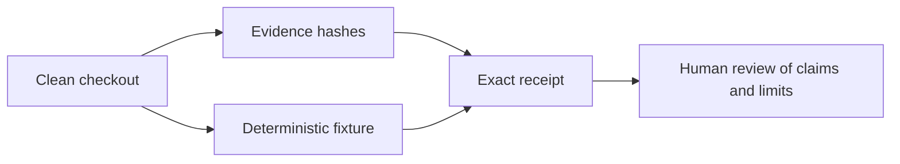

# Independent review

The repository includes a self-contained review kit that runs the first
verification step in one command:

```bash
git clone https://github.com/ryanpavlicek/pyaegean.git
cd pyaegean
python scripts/reproduce_review.py
```

The script runs on CPython 3.10 through 3.15 using only the standard library
and the checked-out zero-dependency package source. It verifies the SHA-256
digest of every file listed in `review/review-manifest-v1.json` (using each
record's declared byte-exact or canonical-LF hash mode), runs the
project-authored offline benchmark fixture and one baseline-pipeline sentence,
and compares the output against `review/expected-results-v1.json`. When Git is
available, it records the commit hash and rejects a dirty working tree by
default.

The verifier does not use the network, download or run the neural model, write
bytecode, or create a pyaegean cache. The offline fixture checks integrity and
regression stability; reproducing the published neural scores requires the
pinned evaluation protocol in [Benchmarks](Benchmarks).

## What a pass establishes



A pass verifies that all tracked public evidence files match their reviewed
digests and that the deterministic offline output matches its expected receipt.
It does not validate scholarly interpretations, rerun external benchmarks, or
constitute external peer review. Pass `--json` to emit the full receipt;
`--allow-dirty` is restricted to local diagnosis.

## Review map

| Resource | Contents |
| --- | --- |
| [Review kit](https://github.com/ryanpavlicek/pyaegean/tree/main/review) | Verification instructions, manifest, model card, data card, and receipt map |
| [Benchmarks](Benchmarks) | Measured scores, sample sizes, protocols, and external comparisons |
| [Methodology](Methodology) | Data splits, model architecture, evaluation protocol, and leakage controls |
| [Data and Provenance](Data-and-Provenance) | Dataset origins, licenses, pinned hashes, and cache boundaries |
| [Limitations](Limitations) | Evidence, licensing, accuracy, and architectural boundaries |
| [Validation and Review](Validation-and-Review) | Internal verification, TUI review, research bundles, and external review status |

## Report a discrepancy

Open the
[independent-review discrepancy form](https://github.com/ryanpavlicek/pyaegean/issues/new?template=reproduction_discrepancy.yml)
and include the exact command, package version, Git commit or source-archive
hash, manifest digest, deterministic-result digest, environment details,
observed output, and any local modifications.

Contributors interested in ongoing maintenance can select an ownership area in
[`CONTRIBUTING.md`](https://github.com/ryanpavlicek/pyaegean/blob/main/CONTRIBUTING.md)
before opening a large pull request.
