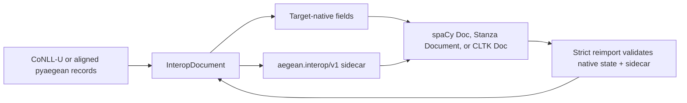

# Interoperability & Interchange Formats

pyaegean moves corpora, annotations, and research snapshots across external NLP
frameworks, digital epigraphy standards, linked open data, the browser
workbench, and portable verification archives.

| Target / Format | Module | Direction | Round-trip contract |
| --- | --- | --- | --- |
| CoNLL-U, spaCy, Stanza, CLTK | `aegean.io` | Read & write | Lossless with `aegean.interop/v1` sidecar; explicit `InteropReport` |
| EpiDoc TEI XML | `aegean.io.epidoc` | Read & write | Semantic TEI via stdlib XML (tokens, lines, apparatus, `<choice>`) |
| RDF Turtle / JSON-LD | `aegean.io.rdf` | Write only | Linked Open Data with canonical URIs and license pass-through |
| Browser workbench bundles & backups | `aegean.io.workbench` | Read & write | Multi-script corpus bundles (`v2.1.0`) + lossless workspace backups |
| Portable research bundles (`.zip`) | `aegean.bundle` | Create, verify, hydrate | Deterministic SHA-256 archive (`aegean-research-bundle/1`), NC-safe |
| Native lossless archive | `Corpus.to_json` / `aegean.db` | Read & write | Lossless internal persistence (see [Data Model](Data-Model)) |

---

## NLP adapters: CoNLL-U, spaCy, Stanza, and CLTK

pyaegean converts aligned Ancient Greek analyses to and from `spacy.tokens.Doc`,
`stanza.Document`, and CLTK `Doc` objects for comparison, substitution, and
mixed-tool workflows. Each export pairs the target-native object with a
versioned `aegean.interop/v1` JSON sidecar and an `InteropReport` listing which
fields live natively on the target, which travel in the sidecar, and which a
lossy projection drops.

### Optional dependencies

```bash
pip install "pyaegean[spacy]"       # spaCy Doc adapter
pip install "pyaegean[stanza]"      # Stanza Document adapter (installs PyTorch)
pip install "pyaegean[cltk]"        # CLTK Doc/Process adapter (Python 3.13+ upstream)
pip install "pyaegean[interop]"     # spaCy + Stanza (+ CLTK on Python 3.13+)
pip install "pyaegean[cli,interop]" # adapters plus CLI interop commands
```

These extras stay separate from `pyaegean[all]`. pyaegean's own neural pipeline
uses ONNX Runtime without PyTorch; only `pyaegean[stanza]` pulls in PyTorch.
Importing `aegean` or `aegean.io` imports none of the three frameworks; a
missing extra raises `InteropDependencyError` with an install command only when
its adapter is called.

### Canonical model and sidecar integrity

The structural source of truth is pyaegean's complete CoNLL-U document model
(`greek.UDDocument`): comments, all ten columns, multiword-token ranges, empty
nodes, enhanced dependencies, ordered MISC entries, opaque lenient rows, and
original line endings. `InteropDocument` additionally carries:

- exact source text and `SourceAlignment`;
- typed editorial forms (`TokenFormState`), calibrated confidence, and analysis
  receipts;
- inference annotation-profile identity and composed output-profile identity;
- corpus provenance.

Because none of the external document objects represents all of those fields
natively, every export produces two paired artifacts:

1. the target framework's standard document object populated with every field it
   supports;
2. a hash-bound `aegean.interop/v1` JSON sidecar carrying the remaining fields.

`InteropReport` separates `native_fields`, `sidecar_fields`, and `lost_fields`;
`report.lossless` is `True` only when `lost_fields` is empty. Strict reimport
verifies the native-projection digest against the sidecar so modified, stale, or
mismatched token order, text, offsets, or annotations raise an error on import.
This verifies structural integrity, not cryptographic authenticity.



### Field support by target

"Sidecar" means the field round-trips intact via the sidecar without being
exposed as a native attribute on the target object.

| Field | CoNLL-U | spaCy `Doc` | Stanza `Document` | CLTK `Doc` |
| --- | --- | --- | --- | --- |
| Token text, lemma, UPOS/XPOS, morphology | native | native | native | native |
| Basic dependency head and relation | native | native | native | native |
| Sentence order and boundaries | native comments/order | native starts; IDs in sidecar | native, including `sent_id` | native boundaries; IDs in sidecar |
| Exact whitespace and source offsets | sidecar when supplied | sidecar (spaCy has boolean trailing space) | native where supported + sidecar | native raw offsets when exact + sidecar |
| Multiword-token ranges | native | sidecar | native token ranges + sidecar for exact rows | sidecar |
| Empty nodes and opaque rows | native | sidecar | sidecar | sidecar |
| Enhanced dependencies and ordered MISC | native | sidecar | native word strings where supported + sidecar | sidecar |
| Typed editorial form state | native reserved MISC + sidecar | sidecar | sidecar | sidecar |
| Calibrated confidence and abstention evidence | sidecar | sidecar | sidecar | selected native fields + complete sidecar |
| Analysis receipt, profile identities, provenance | sidecar | sidecar | sidecar | namespaced metadata + sidecar |

Adapters never reconstruct character offsets with `str.find()`, which breaks on
repeated tokens, combining marks, and Unicode normalization. Exact alignment
must already be present, or the report marks alignment unavailable.

### Python workflow

```python
from pathlib import Path

from aegean.io import from_conllu, from_spacy, to_spacy

canonical = from_conllu(Path("treebank.conllu")).value
exported = to_spacy(canonical)

doc = exported.value                 # spacy.tokens.Doc
exported.report.lossless             # True
exported.report.sidecar_fields       # machine-readable disclosure

restored = from_spacy(doc, sidecar=exported.sidecar).value
restored.ud_document.dumps()         # complete canonical CoNLL-U document
```

`to_stanza`/`from_stanza` and `to_cltk`/`from_cltk` follow the same interface.
Conversion runs no models and performs no network requests.

Strict reimport is the default: missing or mismatched sidecars raise
`InteropLossError`. Pass `allow_lossy=True` to accept only the target-native
projection and inspect `report.lost_fields`:

```python
projected = from_spacy(doc_without_sidecar, allow_lossy=True)
print(projected.report.lossless, projected.report.lost_fields)
```

### Portable CLI adapter bundles

Because external NLP frameworks use version-dependent binary formats, the CLI
reads and writes a self-contained JSON adapter bundle holding the target-native
projection, sidecar, version metadata, and loss report:

```bash
aegean greek interop export treebank.conllu --target spacy -o treebank.spacy.json
aegean greek interop report treebank.spacy.json
aegean greek interop import treebank.spacy.json -o treebank-restored.conllu
```

`export` requires the target extra to construct and verify the native object.
`report` and `import` validate the bundle without loading external models and
restore the complete sidecar-backed CoNLL-U document.

### Serializer caveats and CLTK pipeline integration

- **spaCy:** `Doc.to_bytes()` preserves `Doc.user_data`. `DocBin` preserves it
  only with `store_user_data=True`; the default `False` drops the sidecar.
- **Stanza:** `to_dict()` and `to_serialized()` retain standard Stanza fields
  only; store `exported.sidecar` or the CLI bundle alongside serialized Stanza
  documents.
- **CLTK:** the namespaced sidecar is stored in `Doc.metadata` and also returned
  separately on `InteropResult.sidecar`.
- **CLTK process wrapper:** `make_cltk_process(pipeline)` wraps an explicit
  pyaegean `GreekPipeline` instance as a CLTK process without modifying
  module-global state, triggering downloads, or discarding unrelated CLTK
  document metadata.

### Scope boundaries for NLP adapters

- Sidecar-preserved MWTs or empty nodes are transferred annotations, not
  predictions from pyaegean's `v3` neural model.
- Adapters transfer inference and output profile identities without converting
  annotation conventions (e.g. Perseus vs PROIEL tagsets).
- A stripped native projection (`allow_lossy=True`) always reports
  `lossless=False`.

---

## EpiDoc TEI XML (`aegean.io.epidoc`)

`to_epidoc`, `write_epidoc`, `from_epidoc`, and `read_epidoc` convert between
`Corpus`/`Document` and EpiDoc TEI XML using only Python's standard library XML
parser (no extra dependencies):

```python
from aegean.io import to_epidoc, write_epidoc, from_epidoc, read_epidoc
import aegean

corpus = aegean.load("lineara")
xml_str = to_epidoc(corpus.get("HT13"))
write_epidoc(corpus.get("HT13"), "ht13.xml")

reloaded = from_epidoc("ht13.xml")         # Corpus from a file or directory
```

- **Token carriers:** `<w>` (word), `<num>` (numeral, preserving `@value` in
  `annotations["epidoc:num_value"]`), `<g>` (logogram), `<pc>` (punctuation),
  and `<seg type="...">` (separators, unknown tokens, or tokens carrying inline
  apparatus).
- **Editorial apparatus:** `<unclear>`, `<supplied>`, `<gap>`, and
  `<choice><reg>…</reg><orig>…</orig></choice>` populate both `ReadingStatus`
  and typed `TokenFormState`, and are emitted semantically by `to_epidoc()`.
- **Linear B DAMOS EpiDoc:** free-text DAMOS XML files without token carriers
  use `aegean.scripts.linearb.load_epidoc_corpus` / `parse_epidoc` (requires
  `pip install "pyaegean[epidoc]"` for `lxml`).

---

## Linked Open Data RDF (`aegean.io.rdf`)

`to_rdf(corpus, path, *, fmt="turtle", base_uri=None)` exports a corpus as RDF
Turtle (`fmt="turtle"` / `"ttl"`) or JSON-LD (`fmt="jsonld"` / `"json-ld"`)
using only the standard library (no `rdflib`). CLI equivalents:
`aegean export CORPUS -f ttl -o out.ttl` and `-f jsonld -o out.jsonld`.

```python
import aegean
from aegean.io import to_rdf

corpus = aegean.load("lineara")
to_rdf(corpus, "lineara.ttl", fmt="turtle")
to_rdf(corpus, "lineara.jsonld", fmt="jsonld")
```

- **Subject URI priority:** (1) `http://papyri.info/ddbdp/<hybrid>` for DDbDP
  papyri (from `DDb <hybrid>` notes or the lazily fetched `ddbdp-uris` map,
  matching papyri.info's byte-exact `http://` IRIs, with Trismegistos moved to
  `rdfs:seeAlso`); (2) `https://www.trismegistos.org/text/<id>` for EDH/DDbDP
  `TM` notes; (3) `http://sicily.classics.ox.ac.uk/inscription/ISic...` for
  I.Sicily IDs; (4) fragment URIs under `base_uri` (default `urn:aegean:`).
- **Vocabularies:** `dcterms` (`identifier`, `title`, `license`, `source`,
  `spatial`, `temporal`, `language`), `dctype:Text`, `rdf`/`rdfs`, and WGS84
  `geo:lat`/`geo:long` when coordinates are present.
- **License pass-through:** `dcterms:license` preserves the corpus license (as a
  Creative Commons/SPDX URI or verbatim string), including NonCommercial terms.
- **Export-only:** `to_rdf` has no inverse reader, and per-token editorial
  apparatus stays in lossless JSON or SQLite.

---

## Browser workbench bundles and workspace backups (`aegean.io.workbench`)

pyaegean exchanges corpora and researcher workspace state with the multi-script
browser workbench (`v2.1.0`, bundled with self-hosted Noto Sans Aegean fonts for
Linear A, Linear B, Cypriot Syllabic, and Cypro-Minoan, plus Linear B
`to-so`/`o-pe-ro` accounting).

### Multi-script corpus bundles

`to_workbench_bundle(corpus, path=None)` writes a schema-v1 multi-script JSON
envelope containing `_meta.script`, `inscriptions`, `signs` (from the script's
`SignInventory`), and `phoneticMap`:

```python
import aegean
from aegean.io import to_workbench_bundle, from_workbench_export

damos = aegean.load("damos")
bundle = to_workbench_bundle(damos, "damos-workbench.json")

# Load any workbench schema-v1 export or plain inscription array back into a Corpus
reloaded = from_workbench_export("damos-workbench.json")
```

`to_workbench(corpus, path=None)` emits the legacy plain array of inscription
records. On the CLI, `aegean workbench --corpus <id-or-path>` calls
`to_workbench_bundle` automatically and serves the corpus directly to the local
browser UI.

The workbench format stores token text and inline Linear A apparatus (erased
marks and brackets are re-classified on `from_workbench_export`), not
out-of-band `Token.annotations` or review stamps. Use `Corpus.to_json` or
`aegean.db.to_sqlite` for lossless token annotation storage.

### Workspace state backups (`WorkbenchBackup`)

`load_workbench_backup` and `save_workbench_backup` read and atomically write
`linear-a-workbench-backup` v1 JSON files (`annotations`, `collections`,
`findings`, `notes`, `hypotheses`, `saved_queries`, `tablet_categories`,
`custom_languages`, `pins`), preserving any additional workbench keys in
`backup.extra` for lossless round-trips:

```python
from aegean.io import load_workbench_backup, save_workbench_backup
import aegean

backup = load_workbench_backup("workspace.json")
print(len(backup.annotations), len(backup.findings), len(backup.notes))

# Convert a saved workbench query directly into FilterRow predicates for Corpus.query()
la = aegean.load("lineara")
if backup.saved_queries:
    rows = backup.to_filter_rows(0)
    matches = la.query(rows, output="inscriptions")

save_workbench_backup(backup, "workspace-updated.json")
```

Mount the same file live in the browser UI with
`aegean workbench --corpus lineara --state workspace.json`; edits made in the
browser sync back atomically over loopback (`/api/local/backup`).

---

## Reproducible research bundles (`aegean.bundle`)

`aegean.bundle` packages a complete study snapshot into a single deterministic,
SHA-256-verified `.zip` archive (`aegean-research-bundle/1`) containing an
optional corpus (or license-clean retrieval pointer), `CITATIONS.bib` /
`CITATIONS.txt` / `citations.json`, review CSVs (automatically paired with
`.companion.json` snapshots), analysis/evaluation receipts, optional
`workbench-state.json`, and study metadata.

### License-clean corpus handling

`create_bundle` checks the corpus license with `is_redistributable_license()`:

- `embed_corpus="auto"` (default): embeds open-licensed corpora as
  `corpus.json.gz`; for NonCommercial (`CC BY-NC*`) or restricted corpora, omits
  the corpus bytes and records a `CorpusReference` retrieval pointer (`dataset`,
  `version`, `script_id`, `sha256`, `url`, `license`, `filter_spec`) so the
  archive remains redistributable.
- `embed_corpus="never"`: always emits a `CorpusReference` pointer without
  embedding corpus text.
- `embed_corpus="always"`: embeds the corpus even under NC/restricted terms and
  stamps `manifest.redistributable = False` with an explicit license note.

### Python API

```python
import aegean
from aegean.bundle import create_bundle, inspect_bundle, verify_bundle, hydrate_bundle

la = aegean.load("lineara").filter(site="Haghia Triada")

manifest = create_bundle(
    "ht-study.zip",
    corpus=la,
    dataset="lineara",
    filter_spec={"site": "Haghia Triada"},
    title="Haghia Triada Linear A study",
    workbench_state="workspace.json",
    review_paths=["review.csv"],
    receipts=["receipt.json"],
    embed_corpus="auto",
)

# Inspect manifest without unpacking
info = inspect_bundle("ht-study.zip")
print(info.format, info.redistributable, len(info.members))

# Verify archive safety (no symlinks / path traversal / extra members) and all SHA-256 digests
report = verify_bundle("ht-study.zip")
assert report.ok, report.errors

# Reconstruct live Corpus, WorkbenchBackup, review file paths, receipts, and citations
hydrated = hydrate_bundle("ht-study.zip", dest="unpacked-study", allow_fetch=False)
print(len(hydrated.corpus), hydrated.workbench_state is not None, hydrated.review_files)
```

For bundles carrying a `CorpusReference` pointer to an uncached remote dataset
(such as `damos` or `sigla`), `hydrate_bundle(..., allow_fetch=True)` fetches
the pinned dataset directly from its upstream source under its upstream license
and reapplies `filter_spec`. `extract_bundle(path, dest)` performs verified
safe extraction to disk without constructing Python objects.

### CLI commands

```bash
aegean bundle create study.zip --corpus lineara --site "Haghia Triada" \
    --state workspace.json --review review.csv --receipt receipt.json \
    --title "Haghia Triada study"

aegean bundle inspect study.zip
aegean bundle verify study.zip
aegean bundle extract study.zip ./unpacked
aegean bundle hydrate study.zip ./hydrated --fetch
```

---

See [Greek NLP](Greek-NLP#lossless-conll-u-structure-and-the-model-projection)
for the underlying CoNLL-U structural model, [Data Model](Data-Model) for source
alignment and typed forms, [Benchmarks](Benchmarks) for measured accuracy
tables, and [Data & Provenance](Data-and-Provenance) for receipts and licensing.
