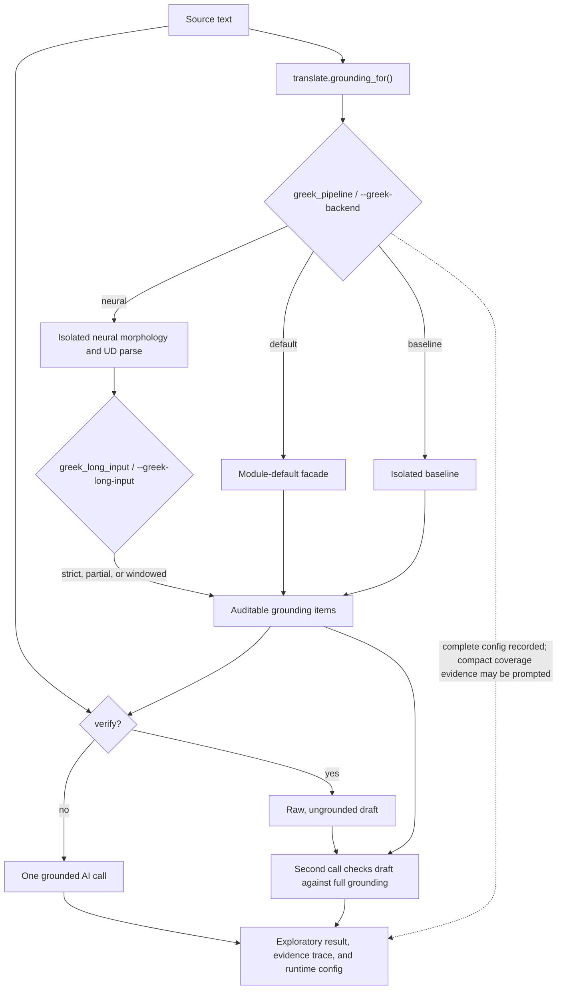

# Translation

`aegean.translate` is a hybrid translator. It builds local, provisional grounding
from pyaegean's analyzers (Greek morphology and dependency syntax, or Linear A
sign-to-sound transliteration) and supplies that evidence alongside the source text
to the key-gated [AI Layer](AI-Layer). Local analysis is deterministic; the
resulting translation is an exploratory model hypothesis with explicit provenance.

> **Scope warning:** `aegean.translate` pairs local analysis with an external or
> local LLM configured by the caller. Every call returns an `ExploratoryResult`
> labeled `EXPLORATORY`, carrying the grounding evidence and its status. Outputs
> are never verified translations. For undeciphered Linear A, the output is a
> speculative guess over phonetic sign values, never a decipherment. See
> [Limitations](Limitations).

Without grounding, an LLM translates Ancient Greek from training memory alone.
With grounding, the prompt carries locally predicted lemmas, parts of speech,
case, voice, clause structure, and matched idiom glosses, with provenance and
coverage recorded in the trace. Incorrect local predictions can still mislead a
model; edition annotations and human field decisions can be supplied separately.

For the remaining generative capabilities (gloss, decipherment hypotheses, ask,
summarize, extract), provider setup, response caching, and grounding evaluation,
see [AI Layer](AI-Layer).

---

## Overview

```python
from aegean import translate

# build local grounding, then call the model
r = translate.translate("ἦν ὁ λόγος", script="greek", client=client)
print(r.labeled())     # translation with EXPLORATORY header
print(r.trace())       # local evidence, status, and audit data
```

```bash
# CLI translate routes through the hybrid translator
aegean ai translate "ἦν ὁ λόγος" --script greek --target English --trace
aegean ai translate "ἦν ὁ λόγος" --greek-backend neural --verify --check-policy clauses --trace
aegean ai translate "KU-RO DA-RO" --script lineara    # exploratory: Linear A is undeciphered
echo "μῆνιν ἄειδε θεά" | aegean ai translate -         # '-' reads stdin
```

The Python module exposes two functions:

| Function | Returns | Purpose |
| --- | --- | --- |
| `translate.translate(text, *, script=, target=, mode=, glosses=, lexical_evidence=, verify=, check_policy=, style=, source_context=, max_tokens=, greek_pipeline=, greek_long_input=, grounding_failure=, grounding=, client=)` | `ExploratoryResult` | Build local grounding, attach supplied evidence and optional `source_context`, and call the model (optionally checking with `verify=True` and `check_policy="clauses"`). |
| `translate.grounding_for(text, script, *, mode=, glosses=, lexical_evidence=, greek_pipeline=, greek_long_input=, grounding_failure=)` | `list[GroundingItem]` | Return local grounding without making a provider call (set `lexical_evidence="contextual"` for bounded dictionary sense excerpts with construction cues from active lexica). |

Both are re-exported from `aegean.translate`. The CLI command `aegean ai
translate` calls `translate.translate` and exposes `--check-policy clauses`,
`--lexical-evidence contextual`, repeatable `--dictionary ID`,
`--source-context` / `--source-context-file`, and `--max-tokens`.

---

## The grounding: what the model is told

`grounding_for` returns local `GroundingItem` records tagged with source, status,
and provenance so `trace()` records where each fact originated. Greek morphology
and clause skeletons carry status `predicted`. Grounding defaults to best-effort:
if a required analysis stage fails, available evidence is still returned and
`translate(...).trace()` records the failed stage and exception type. Set
`grounding_failure="strict"` to abort with `GroundingError` before any provider
call when a required stage is missing or fails. Absent optional dictionaries, an
uncached rarity corpus, and unmatched idioms are normal under both policies.
Invalid arguments (such as an unknown `mode`) raise `ValueError`.

In `morphology` and `full` modes, `strict` also requires dependency parsing. An
isolated baseline pipeline carries no parser, so pair `--greek-backend baseline`
with `best-effort` or select `--greek-backend neural` when strict syntax grounding
is required. `lemma` mode requests no dependency parse.

```python
from aegean import translate

translate.grounding_for("ἦν ὁ λόγος", "greek")
# [GroundingItem('ἦν = εἰμί (verb, ...)',   'analysis:morphology', 'ἦν'),
#  GroundingItem('ὁ = ὁ (det)',              'analysis:morphology', 'ὁ'),
#  GroundingItem('λόγος = λόγος (noun, ...)', 'analysis:morphology', 'λόγος')]

translate.grounding_for("KU-RO DA-RO", "lineara")
# [GroundingItem('KU-RO → /kuro/', 'transliteration', 'KU-RO'),
#  GroundingItem('DA-RO → /daro/', 'transliteration', 'DA-RO')]
```

For Greek, grounding runs `greek.pipeline(text, parse=True)` and produces
per-token morphology lines, a clause skeleton from the dependency parse, rare-word
flags, and glosses for matched non-compositional idioms. For Linear A, grounding
produces sign-to-sound transliterations of hyphenated words (phonetic values of
signs, never lexical meanings). Any other `script` produces no automatic
grounding.

### Which Greek backend supplies the grounding?

`greek_pipeline=` selects the Greek analyzer explicitly in Python. Omitting it
uses the module-level default facade: a fresh process starts on the
zero-dependency baseline, and `greek.use_neural_pipeline()` switches subsequent
module-level calls to the neural backend. Pass `greek.GreekPipeline()` for an
isolated baseline or `greek.GreekPipeline.neural()` for an isolated neural
instance. Explicit instances neither read nor mutate process-global defaults, and
the same analyzed token records feed morphology, idiom lemma matching, rarity
gating, and dictionary lookups.

```python
from aegean import greek, translate

neural = greek.GreekPipeline.neural(variant="default")
result = translate.translate(
    "ἦν ὁ λόγος",
    script="greek",
    greek_pipeline=neural,
    greek_long_input="strict",
    client=client,
)
```

On the CLI, `--greek-backend default|baseline|neural` selects the same behavior
(`default` uses the facade; `baseline` and `neural` construct isolated instances
for that invocation). Under `neural`, `--greek-variant default|fast|compact|balanced`
selects the runtime artifact. Currently only `default` is published; reserved
labels fail before any provider call with no fallback. By contrast, lower-level
`aegean.ai.translate` performs no automatic Greek analysis and forwards only
explicit `grounding=` items.

Pipeline ownership and long-input handling are configured independently.
`greek_long_input` (CLI `--greek-long-input`) defaults to `"strict"`. `"partial"`
keeps explicitly marked placeholders and records a coverage degradation;
`"windowed"` invokes overlapping whole-word reconciliation in the neural pipeline.
The chosen policy is recorded in runtime provenance and never added to the model
prompt. Non-Greek or baseline calls reject non-default Greek options with an error.



`trace()`, `provenance()`, and JSON exports record the selected pipeline, its
immutable configuration, grounding mode, long-input and failure policies, and any
best-effort degradations. The complete runtime block is attached after completion
and never enters either prompt; compact backend identity, unavailable-stage, and
coverage summaries may appear separately as prompted `GroundingItem`s.

Pass supplemental evidence via `grounding=`, such as
`ai.annotation_evidence(doc.words, source="My edition", source_annotated=True)`.
This helper separates source annotations, predictions, current per-field human
decisions, and unclassified inputs. Only an accept or correct decision carrying
its verification flag receives `human-reviewed` status; reviewing a lemma does not
verify POS, morphology, or dependencies. Deferred, rejected, and stale decisions
remain visible. Supplied evidence augments automatic predictions, and `mode="none"`
retains supplied items while disabling automatic analysis.

### Grounding modes (Greek)

For Greek, `mode` controls how much local analysis enters the prompt. The default
is morphology-first because injecting an automatic lead dictionary sense often
surfaces an archaic or out-of-context definition. Morphology, voice, case, and
clause structure provide inspectable provisional evidence whose accuracy tracks
the active backend.

| `mode` | Grounding included | Use case |
| --- | --- | --- |
| `"morphology"` (default) | Predicted per-token lemma, POS, case/voice/tense; predicted clause skeleton (predicate, subject, object) from the dependency parse; rare-word flag; idiom glosses. Excludes ordinary dictionary glosses. | General Greek translation with inspectable grammatical evidence. |
| `"full"` | Everything in `"morphology"` plus concise dictionary glosses gated to rare content words. | Rare, technical, or documentary vocabulary prone to misreading. |
| `"lemma"` (legacy) | Lemma lines plus gated content-word LSJ glosses. | Compatibility with earlier lemma-only grounding. |
| `"none"` | No automatic grounding; explicitly passed `grounding=` items are kept. | Bare-text baseline or caller-supplied grounding only. |

An unrecognized `mode` raises `ValueError` listing the valid modes.

Glosses in `"full"` come from a common-sense-first dictionary cascade (Middle
Liddell, Cunliffe for Homer, Abbott-Smith / Dodson for the New Testament),
cleaned and restricted to flagged rare words:

```python
translate.grounding_for("σπεῖρε τὴν ἄρουραν", "greek", mode="full")
# morphology lines per token, rarity flag, and concise glosses for
# flagged rare content words (σπεῖρε, ἄρουραν) when a concise lexicon is loaded.
```

The rarity gate consults the full SHA-256-verified NT only when already cached in
the local store. It initiates no downloads and never substitutes the bundled
two-chapter sample. If the full NT is absent, morphology grounding runs normally
without rarity flags.

The `"full"` gloss cascade excludes LSJ's first sense because LSJ orders senses
etymologically, placing archaic meanings first (for example, καιρός, βίος,
λόγος). If no concise dictionary is loaded (via `greek.use_lexicon("middle-liddell")`
and peers), `"full"` simply omits gloss lines. See
[AI Layer → Gated LSJ gloss grounding](AI-Layer#gated-lsj-gloss-grounding) for
gating details and `ai.grounding.content_glosses`.

### Grounding depends on the active lemmatizer

Coverage of inflected forms and clause skeletons depends on the chosen Greek
backend. The bundled baseline strips regular second-declension and thematic-verb
endings but misses irregular and unlisted forms. `translate.translate` emits a
warning when only the baseline is active. Use `greek_pipeline=GreekPipeline.neural()`
(CLI `--greek-backend neural`) for contextual neural morphology and dependency
parsing, or activate `greek.use_treebank()` / `greek.use_neural_pipeline()` on
the compatibility facade. See [Greek NLP](Greek-NLP) for measured backend accuracy.

---

## Idiom / multiword-expression grounding

Per-token morphology cannot capture non-compositional idioms whose phrase meaning
diverges from their parts: `ἐφ' ἡμῖν` means "in our power" ("upon us" literally),
`οὐκ ἔστιν ὅπως` means "there is no way that", and `οἷός τε εἰμί` means "be able
to". Token lemmas and cases reinforce a literal reading, so phrase-level idiom
glosses are included by default in both `mode="morphology"` and `mode="full"`.

The lexicon is a curated bundled file (`data/bundled/greek/idioms.json`), not an
exhaustive dictionary. `ai.idiom_glosses(text)` returns one `GroundingItem` per
match (source `lexicon:idiom`) and never raises:

```python
from aegean import ai
ai.idiom_glosses("διὰ τοῦτο ἐφ' ἡμῖν ἐστιν")
# [GroundingItem('διὰ τοῦτο: for this reason, therefore', 'lexicon:idiom', 'διὰ τοῦτο'),
#  GroundingItem("ἐφ' ἡμῖν: in our power, up to us", 'lexicon:idiom', "ἐφ' ἡμῖν")]
```

Matching uses surface forms and lemmas (no full syntactic parser):

- **surface** (primary): accent-insensitive matching with elision and apostrophes
  normalized away, matching fixed idioms including elided and gapped-correlative
  forms (such as `οὐ μόνον ... ἀλλὰ καί`).
- **contiguous lemma match** (secondary): matching an idiom's content lemmas as an
  adjacent run in the text's lemma sequence, catching inflected variants
  (`οἷός τε ἐστί` for `οἷός τε εἰμί`) while avoiding scattered function words.
  Coverage tracks the active lemmatizer.

On overlapping spans, the longest idiom wins and shorter sub-idioms are suppressed;
duplicate glosses are removed. Idiom glosses provide lexical hints, not syntactic
annotations.

---

## Post-hoc verify: translate, then check and repair

`verify=True` (Greek only) runs a two-call translate-then-check workflow that
isolates the first draft from local analysis:

1. Call 1 translates the text ungrounded so local predictions cannot bias the
   initial draft.
2. Call 2 checks the draft against full grounding (morphology, idioms, and concise
   rare-word glosses, equivalent to `mode="full"`) and repairs definite
   contradictions (wrong voice, subject/object swap, case relation, rare-word or
   idiom sense, omission, or addition) while keeping valid phrasing. Incorrect
   local grounding can still mislead this pass, and quality gains are not
   guaranteed.

The complete draft result, including its uncertainty notes and provenance, is
preserved in `r.draft`. Model-reported changes, reasons, and evidence are stored
separately from the translation text. These checks are model outputs, never human
review or independent verification.

```python
r = translate.translate("ἦν ὁ λόγος", script="greek", verify=True, client=client)
```

```bash
aegean ai translate "ἦν ὁ λόγος" --script greek --verify
```

Because grounding enters only in the second call, it cannot bias the draft; the
repair step still depends on grounding accuracy. For Greek, `verify=True`
supersedes `mode` (always passing full grounding to the checker). For non-Greek
scripts, `verify` has no effect and a single call runs. Full grounding is built
before Call 1 so `grounding_failure="strict"` aborts before spending a provider
call. See [Recipe 26](Recipes#26--choose-a-greek-ai-translation-workflow) for
workflow selection.

### Translation text and audit data

`style="annotated"` (default; CLI `--style annotated`) displays model-reported
uncertainty and change notes in labeled output. `style="concise"` prints the
translation concisely while preserving audit details in `data`, JSON, and
`trace()`. For structured responses, `r.text` contains only the translation, while
`r.data` holds `translation`, `uncertainties`, `changes` (with reasons and
evidence), `raw_response`, and `format_status`. Schema validation verifies output
shape, not linguistic correctness. A single outer JSON code fence is parsed
locally; malformed responses remain verbatim with `format_status="unstructured"`
and trigger no repair call.

When draft and final responses are both structured, exact text comparison records
`text_changed` and flags altered wording omitted from the model's change list.
This comparison checks string equality only. Both styles preserve `draft` in JSON
and `trace()`, and saved translation `.txt` files append the trace automatically.

Repeated checking carries prior draft notes and raw responses forward. Annotated
output displays prior uncertainty notes; concise output displays their counts. An
omitted note in a later pass does not mean an uncertainty was resolved. If history
begins with a plain string, its exact wording is kept without fabricating notes or
provenance.

Mutating `r.text` after generation leaves stored responses and audit data intact;
labeled, notebook, and trace views flag stored reports as historical when wording
diverges. Mutating only `r.draft.text` invalidates the exact draft comparison,
while clause checks still apply to unchanged final text. JSON exports preserve all
stored fields verbatim; compare `text` against `data["translation"]` and
`draft.text` against `data["draft_text"]` before relying on stored audit fields.

---

## Providers: the key-gated `[ai]` layer

Translation shares the six providers of `aegean.ai`: five hosted services
(Anthropic, OpenAI, Grok, Gemini, OpenRouter) and `local` for OpenAI-compatible
local servers (Ollama, LM Studio, llama.cpp, vLLM) without an API key or network
access. See
[AI Layer → Using a local model](AI-Layer#using-a-local-model-ollama-lm-studio-llamacpp-vllm).
Core pyaegean has zero third-party dependencies; provider SDKs are optional extras
imported lazily on call. Keys are read from environment variables and never logged.

| Provider | id | Key env var | Default model |
| --- | --- | --- | --- |
| Anthropic (default) | `anthropic` | `ANTHROPIC_API_KEY` | `claude-sonnet-4-6` |
| OpenAI | `openai` | `OPENAI_API_KEY` | `gpt-4o` |
| xAI Grok | `grok` | `XAI_API_KEY` | `grok-2-latest` |
| Google Gemini | `gemini` | `GEMINI_API_KEY` | `gemini-2.5-pro` |
| OpenRouter | `openrouter` | `OPENROUTER_API_KEY` | `openai/gpt-4o-mini` |

Install a single provider or install all three SDKs via `[ai]` (Grok, OpenRouter,
and `local` share the `openai` SDK):

```bash
pip install "pyaegean[anthropic]"    # default provider
pip install "pyaegean[ai]"           # all provider SDKs
pip install "pyaegean[cli]"          # `aegean` CLI
```

Models resolve in order: explicit `model=`, `<PROVIDER>_MODEL`, then built-in
default. Pass an explicit client with `translate.translate(..., client=...)`; when
omitted, a fresh Anthropic client is created. See
[AI Layer → Providers & clients](AI-Layer#providers--clients),
[Model selection](AI-Layer#model-selection), and [Installation](Installation).

---

## Every output is exploratory and provenanced

`translate.translate` returns an `ExploratoryResult` carrying the caveat and
grounding alongside the text:

```python
r = translate.translate("ἦν ὁ λόγος", script="greek", client=client)

r.labeled()      # translation prefixed with EXPLORATORY header
r.trace()        # evidence status, audit data/draft, and local runtime config
r.provenance()   # provider/model/prompt, grounding, and grounding_runtime
r.exploratory    # always True; preserved across save and reload
```

Display `labeled()` to human readers so the exploratory tag travels with the text:

```text
[EXPLORATORY · translate · anthropic/claude-sonnet-4-6]
"was the word" (the copula ἦν + predicate nominal λόγος; …).
```

`trace()` lists every grounding item and its status, and flags ungrounded calls
explicitly. `grounding_runtime` stores backend configuration, failure policy, and
stage degradations as post-hoc provenance (while compact backend/coverage items
may separately appear in prompts). `.to_json()` and `ExploratoryResult.from_dict`
preserve `exploratory` and provenance on disk. See
[AI Layer → `ExploratoryResult`](AI-Layer#what-every-result-looks-like-exploratoryresult)
and [Saving AI results](AI-Layer#saving-ai-results).

### Linear A and the undeciphered scripts

Linear A is undeciphered. Local grounding supplies only sign-to-sound
transliterations, never lexical meanings, and any generated "translation" is a
speculative guess over phonetic values. Never present it as an attested reading.
For deterministic Linear A analysis and cited decipherment hypotheses, see
[Linear A](Linear-A) and
[AI Layer → Decipherment hypotheses](AI-Layer#decipherment-hypotheses).

---

## CLI reference

`aegean ai translate TEXT` runs the hybrid translator from the shell.

| Flag | Default | Meaning |
| --- | --- | --- |
| `TEXT` | — | Source text. `-` reads stdin. |
| `--script` | `greek` | `greek` or `lineara` (selects local grounding). |
| `--target` | `English` | Target language. |
| `--source-context` | — | Inline source context (edition, genre, speaker, or surrounding passage). |
| `--source-context-file` | — | Read source context from a UTF-8 file (mutually exclusive with `--source-context`). |
| `--max-tokens` | `2048` | Output token limit per translation or checking call. |
| `--style` | `annotated` | `annotated` prints uncertainty/change notes; `concise` shortens output while retaining audit data in JSON and `--trace`. |
| `--mode` | `morphology` | Grounding mode: `morphology`, `full`, `lemma` (legacy), or `none`. |
| `--glosses` / `--no-glosses` | on | Legacy toggle superseded by `--mode`; enables or disables glosses in `lemma`/`full`. |
| `--verify` | off | Greek only: draft raw, then check and repair against full grounding (second call). |
| `--check-policy` | `standard` | `standard` or `clauses`; `clauses` requires `--verify` and `--script greek`, adding explicit role, negation, qualification, and speech-act checks with span validation. |
| `--lexical-evidence` | `concise` | `concise` or `contextual` (bounded excerpts from active dictionaries; requires Greek `full`/`lemma` or `--verify`, with glosses). |
| `--dictionary` | none | Activate a hosted dictionary for this command (repeatable; requires Greek `full`/`lemma` or `--verify`, with glosses). |
| `--greek-backend` | `default` | `default` (module facade), `baseline` (isolated), or `neural` (isolated joint model). Greek only. |
| `--greek-variant` | `default` | Runtime artifact for `--greek-backend neural`: `default`, `fast`, `compact`, or `balanced`. Only qualified labels are accepted. Greek only. |
| `--greek-long-input` | `strict` | Neural long-input policy: `strict`, `partial`, or `windowed`. Greek only. |
| `--grounding-failure` | `best-effort` | `best-effort` keeps available evidence and records degradations; `strict` aborts before any provider call on required-stage failure. |
| `--provider` | `anthropic` | `anthropic`, `openai`, `grok`, `gemini`, `openrouter`, or `local`. |
| `--model` | provider default | Model override. |
| `--output` / `-o` | — | Save result (`.json` full result; `.txt` labeled text plus audit trace). |
| `--trace` | off | Print grounding provenance under the answer. |
| `--json` | off | Emit one JSON document to stdout. |

```bash
aegean ai translate "σπεῖρε τὴν ἄρουραν" --script greek --mode full --trace
aegean ai translate "ἦν ὁ λόγος" --greek-backend neural --verify --trace
aegean ai translate "KU-RO DA-RO" --script lineara --trace   # exploratory
```

Shared CLI conventions (`-` for stdin, `--json`, `--output/-o`) are documented on
[CLI](CLI).

---

## Notes & limitations

- **Outputs are hypotheses, not verified translations.** The exploratory label,
  provenance trace, and [grounded-generation eval](AI-Layer#grounded-generation-eval)
  enforce this boundary. For undeciphered scripts, outputs are never attested
  readings.
- **Grounding quality bounds the aid.** Stronger lemmatizers and neural parsing
  increase token and clause coverage in the grounding prompt; erroneous parses can
  mislead either a grounded translation or a verification pass.
- **Use deterministic tools where available.** Use [Greek NLP](Greek-NLP) for
  tagging, lemmatization, scansion, and syntax, and [Analysis](Analysis) /
  [Linear A](Linear-A) for tablet accounting. Check model output against them.
- **Credentials and costs are caller-managed.** No provider call runs until a
  client is invoked; use the AI layer's [response cache](AI-Layer#response-caching)
  to reuse repeated completions.

See [AI Layer](AI-Layer) for the rest of the generative API and
[Limitations](Limitations) for project-wide evidentiary boundaries.
