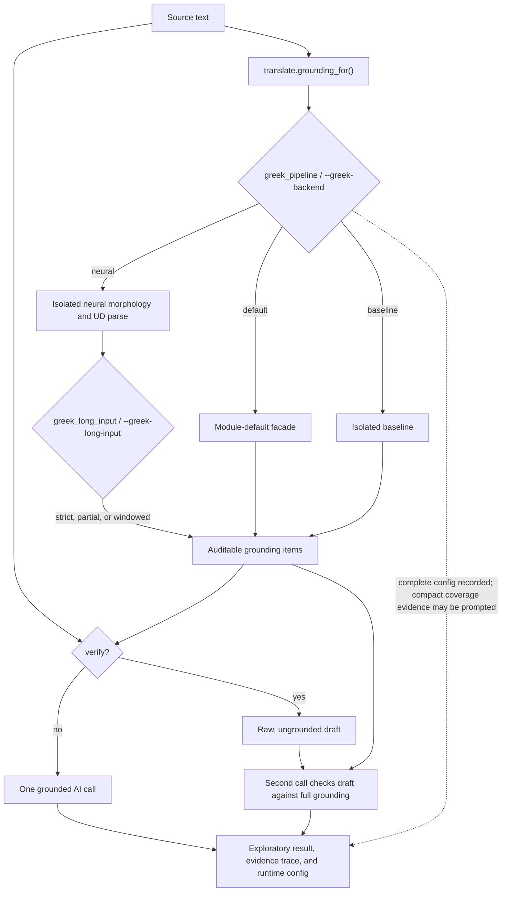

# Translation

`aegean.translate` is pyaegean's **hybrid translator**: it builds local, provisional
grounding from the toolkit's own tooling (Greek morphology and dependency
syntax, or Linear A sign→sound transliteration), then hands the text plus that
evidence to the key-gated [AI Layer](AI-Layer) to produce a translation. The
grounding step is real and local; the translation itself is a **model
hypothesis**, returned as an exploratory, provenanced result like everything
else in the AI layer.

> **Read this first: this is a translation *aid*, not a finished translation
> model.** It pairs the package's local analysis with a general-purpose
> language model you supply a key for. Every output is an `ExploratoryResult`,
> labeled `EXPLORATORY`, carrying the local evidence and its status. It is
> never a citable, verified translation, and on the **undeciphered** scripts
> (Linear A) the "translation" is
> a guess built on a phonetic reading of the signs, never a decipherment. What
> pyaegean can and cannot claim is on the **[Limitations](Limitations)** page.

The idea is simple: a bare model translates Ancient Greek from its training
memory alone. Here, the model receives locally predicted lemmas, parts of speech,
case, voice, and clause structure, plus matched idiom glosses. Their provenance
and coverage are visible. A wrong local prediction can still mislead a model;
source annotations and current human field decisions can be supplied separately.

This page covers the translation layer specifically. For the full generative
surface (gloss, decipherment hypotheses, ask, summarize, extract), the providers
and clients, response caching, and the grounded-generation eval, see the
[AI Layer](AI-Layer).

---

## At a glance

```python
from aegean import translate

# hybrid: build local grounding, then call the model
r = translate.translate("ἦν ὁ λόγος", script="greek", client=client)
print(r.labeled())     # the translation with its EXPLORATORY tag
print(r.trace())       # local evidence, its status, and translation audit data
```

```bash
# the CLI translate command is the hybrid translator
aegean ai translate "ἦν ὁ λόγος" --script greek --target English --trace
aegean ai translate "ἦν ὁ λόγος" --greek-backend neural --trace
aegean ai translate "KU-RO DA-RO" --script lineara    # exploratory: Linear A is undeciphered
echo "μῆνιν ἄειδε θεά" | aegean ai translate -          # '-' reads stdin
```

Two functions make up the Python surface:

| Function | Returns | What it does |
| --- | --- | --- |
| `translate.translate(text, *, script=, target=, mode=, verify=, style=, greek_pipeline=, greek_long_input=, grounding_failure=, grounding=, client=)` | `ExploratoryResult` | Build local grounding, add supplied evidence, then translate. |
| `translate.grounding_for(text, script, *, mode=, greek_pipeline=, greek_long_input=, grounding_failure=)` | `list[GroundingItem]` | Just the local grounding, so you can inspect it before spending a call. |

Both are re-exported from `aegean.translate`. The CLI command `aegean ai
translate` routes through `translate.translate`.

---

## The grounding: what the model is told

`grounding_for` returns local evidence, each item tagged with its **source**, status,
and provenance so the result's `trace()` names where it came from. Greek morphology
and clause skeletons are marked `predicted`. Grounding is
**best-effort by default**. A required analysis failure yields the evidence still
available, and `translate(...).trace()` records the failed stage and exception type.
Use `grounding_failure="strict"` when a missing or incomplete required analysis must
stop the operation. Strict failure raises `GroundingError`. `translate` performs this
check before any provider call. Optional dictionaries, the optional rarity corpus, and
an unmatched idiom remain normal absences under either policy. Invalid arguments such
as an unknown `mode` still raise `ValueError`.

In `morphology` and `full` modes, strict means the requested dependency analysis must
exist too. An isolated baseline deliberately owns no parser, so combine
`--greek-backend baseline` with the default best-effort policy, or select the neural
backend when a strict morphology/parse contract is required. `lemma` mode requests no
dependency parse.

```python
from aegean import translate

translate.grounding_for("ἦν ὁ λόγος", "greek")
# [GroundingItem('ἦν = εἰμί (verb, ...)',  'analysis:morphology', 'ἦν'),
#  GroundingItem('ὁ = ὁ (det)',            'analysis:morphology', 'ὁ'),
#  GroundingItem('λόγος = λόγος (noun, ...)', 'analysis:morphology', 'λόγος')]

translate.grounding_for("KU-RO DA-RO", "lineara")
# [GroundingItem('KU-RO → /kuro/', 'transliteration', 'KU-RO'),
#  GroundingItem('DA-RO → /daro/', 'transliteration', 'DA-RO')]
```

For Greek, the grounding is assembled from `greek.pipeline(text, parse=True)`:
a per-token morphology line, a clause skeleton from the dependency parse, a
rare-word flag, and an idiom gloss for any non-compositional phrase present. For
Linear A, the grounding is the sign→sound transliteration of each hyphenated word
(`analysis` of the signs, not a reading of them). Any other `script` yields no
grounding.

### Which Greek backend supplies the grounding?

The Python API makes the owner explicit with `greek_pipeline=`. Omit it to preserve the
historical **module-level default facade**: a fresh process uses the zero-dependency
baseline, while `greek.use_neural_pipeline()` changes that facade for later module-level
calls. Pass `greek.GreekPipeline()` for an isolated baseline or
`greek.GreekPipeline.neural()` for an isolated neural analyzer. An explicit instance does
not read or replace the module default, and the same analyzed records drive morphology,
idiom lemma matching, rarity gating, and dictionary lookup.

```python
from aegean import greek, translate

neural = greek.GreekPipeline.neural(variant="default")
result = translate.translate(
    "ἦν ὁ λόγος",
    script="greek",
    greek_pipeline=neural,
    greek_long_input="strict",
    client=client,
)
```

The CLI mirrors this with `--greek-backend default|baseline|neural`. `default` preserves
the facade behavior; `baseline` and `neural` create isolated instances for that run. With
the neural owner, `--greek-variant default|fast|compact|balanced` selects the runtime artifact.
Only `default` is currently available; reserved labels fail before any provider call and never
fall back. The
lower-level `aegean.ai.translate` function is different again: it never builds Greek
grounding automatically and only sends evidence passed explicitly through its
`grounding=` argument.

Pipeline ownership and long-input handling are separate choices. `greek_long_input`
(CLI `--greek-long-input`) is `"strict"` by default. `"partial"` retains explicitly marked
placeholders and normally produces an analysis-coverage degradation; `"windowed"` requests
the neural pipeline's overlapping whole-word reconciliation. The selected policy appears
in runtime provenance and is never added to the provider prompt. These choices apply only
to Greek and require a neural backend; non-Greek or baseline calls reject a non-default
Greek policy rather than ignoring it.



`trace()`, `provenance()`, and JSON output record the selected pipeline, its immutable
configuration, the grounding mode, long-input policy and failure policy, and any
best-effort degradation.
That complete runtime block is attached only after model completion and never
enters either prompt. Compact backend identity, unavailable-stage, and coverage
evidence can separately appear as a `GroundingItem` in a grounded prompt.

Pass additional evidence with `grounding=`, for example
`ai.annotation_evidence(doc.words, source="My edition", source_annotated=True)`.
The builder distinguishes source annotations, predictions, current per-field
human decisions, and unclassified origins. Only an accept/correct decision with
the field's verification flag grants `human-reviewed` status; reviewing a lemma
does not certify POS, morphology, or dependencies. Deferred, rejected, and stale
decisions stay visible. Supplied evidence supplements automatic predictions,
and `mode="none"` retains it while disabling automatic grounding.

### Grounding modes (Greek)

For Greek, `mode` selects how much analysis to ground with. The default is
**morphology-first**, deliberately: an auto-selected dictionary gloss can surface
the wrong or an archaic sense and mislead the model. Morphology, voice, case, and
clause structure provide inspectable provisional evidence, with accuracy and
coverage dependent on the selected backend.

| `mode` | Grounds with | When to use |
| --- | --- | --- |
| `"morphology"` (default) | Predicted per-token lemma, part of speech, case/voice/tense; a predicted clause skeleton (predicate, subject, object) from the dependency parse; a rare-word flag; and a gloss of any idiom present. **No dictionary glosses on ordinary words.** | The default local evidence, whose predictions still require interpretation. |
| `"full"` | The `"morphology"` lines (idiom glosses included) **plus** concise dictionary glosses, gated to the text's rare content words. | Rare, technical, or documentary vocabulary a model is likely to misread. |
| `"lemma"` (legacy) | Lemma lines plus gated content-word LSJ glosses. | Back-compatibility with the pre-morphology grounding. |
| `"none"` | No automatic grounding; explicitly supplied `grounding=` evidence is retained. | A bare-text baseline when no supplemental evidence is supplied. |

An unrecognized `mode` raises `ValueError` naming the valid modes, so a typo
never silently falls through to a different grounding style.

The `"full"` glosses come from a **concise, common-sense-first** dictionary
cascade (Middle Liddell, Cunliffe for Homer, Abbott-Smith / Dodson for the New
Testament), cleaned, and gated to the rare words:

```python
translate.grounding_for("σπεῖρε τὴν ἄρουραν", "greek", mode="full")
# morphology lines for each token, plus a rarity flag, plus concise glosses
# for the flagged rare content words (σπεῖρε, ἄρουραν) when a concise
# dictionary is loaded.
```

The rarity gate uses the full, SHA-256-verified NT only when that asset is already
in the local data store. It never downloads an optional reference corpus during a
translation, and it never substitutes the bundled John 1 + Philemon sample. Without
the full corpus, morphology grounding continues and the rarity flag is simply absent.

The gloss cascade is **never** taken from LSJ's first sense: LSJ orders senses
etymologically, so its lead sense is frequently the archaic meaning (καιρός,
βίος, λόγος), and asserting it would inject exactly the errors this layer exists
to avoid. If no concise dictionary is loaded, the `"full"` glosses are simply
absent (load one with `greek.use_lexicon("middle-liddell")` and kin). See the AI
Layer's [gated gloss grounding](AI-Layer#gated-lsj-gloss-grounding) for the
mechanics and `ai.grounding.content_glosses` for the reusable builder.

### Grounding depends on the active lemmatizer

Coverage of rare or inflected forms, and the clause skeleton, depends on the selected
Greek backend. The bundled baseline seed table strips the regular
second-declension and thematic-verb endings but misses irregular and
unrecognized forms, so a grounded translation on those is only partly grounded.
`translate.translate` raises a warning when the selected path has only the baseline.
Pass `greek_pipeline=GreekPipeline.neural()` (CLI `--greek-backend neural`) for
contextual, model-predicted morphology and a dependency parse. The compatibility
facade also continues to support `greek.use_treebank()` and
`greek.use_neural_pipeline()`. See
[Greek NLP](Greek-NLP) for the backends and their measured accuracy.

---

## Idiom / multiword-expression grounding

The one translation-error class per-token morphology structurally cannot reach
is the **non-compositional idiom**, where the phrase means something the words do
not: `ἐφ' ἡμῖν` is "in our power", not "upon us"; `οὐκ ἔστιν ὅπως` is "there is no
way that", not "it is not how"; `οἷός τε εἰμί` is "be able to". A literal,
token-by-token reading is wrong, and the lemma and case lines only reinforce the
literal reading. A phrase-level gloss of the real meaning gives the model the one
fact it needs, so idiom glosses ride with the **default** morphology grounding
(and with `mode="full"`).

The layer is a **curated lexicon** of vetted non-compositional expressions
(bundled as `data/bundled/greek/idioms.json`), not an exhaustive idiom
dictionary. `ai.idiom_glosses(text)` returns one `GroundingItem` per match
(source `lexicon:idiom`), and it is best-effort and never raises:

```python
from aegean import ai
ai.idiom_glosses("διὰ τοῦτο ἐφ' ἡμῖν ἐστιν")
# [GroundingItem('διὰ τοῦτο: for this reason, therefore', 'lexicon:idiom', 'διὰ τοῦτο'),
#  GroundingItem("ἐφ' ἡμῖν: in our power, up to us", 'lexicon:idiom', "ἐφ' ἡμῖν")]
```

Detection is **surface- and lemma-based, not a parser**, and matches two ways:

- **surface** (primary): an accent-insensitive match of the idiom's surface form,
  with elision/apostrophe normalized away, so fixed idioms are caught verbatim
  (including their elided and gapped-correlative spellings, e.g.
  `οὐ μόνον ... ἀλλὰ καί`);
- **contiguous lemma match** (secondary): the idiom's content lemmas appearing as
  an *adjacent* run among the text's lemmas, which catches inflected idioms
  (`οἷός τε ἐστί` for the lexicon's `οἷός τε εἰμί`) without firing on the same
  function words scattered across an unrelated sentence. Its inflection coverage
  tracks the active lemmatizer.

On overlapping matches the longest idiom wins and its shorter sub-idioms are
suppressed; identical glosses are de-duplicated. A gloss is a meaning aid, not a
syntactic claim.

---

## Post-hoc verify: translate, then check and repair

`verify=True` (Greek only) runs a **translate-then-check-and-repair** pass instead
of a single grounded call, at the cost of a second model call. It separates the
initial draft from the local analysis:

1. The text is translated **raw**, with no grounding in the prompt, so the local
   analysis cannot bias the draft.
2. The full grounding (morphology, idiom glosses, and concise glosses, as for
   `mode="full"`) is then supplied to a second call that checks the draft against
   it and is instructed to correct **only** definite contradictions (a wrong voice, subject or
   object, case relation, a rare word's or idiom's sense, an omission or
   addition), keeping the draft where it is already right. A wrong grounding
   prediction can still mislead this pass; no quality improvement is guaranteed.

The complete original result, including its uncertainty notes and provenance,
remains in `r.draft`. The final translation reports changes with their reasons
and evidence separately from the text. These are model reports, not human review
decisions or independent scholarly verification.

```python
r = translate.translate("ἦν ὁ λόγος", script="greek", verify=True, client=client)
```

```bash
aegean ai translate "ἦν ὁ λόγος" --script greek --verify
```

Because the grounding only ever reaches the checker, it cannot bias the initial
draft. A wrong analysis can still mislead the repair step, so the pass is only as
sound as the grounding it checks against. `verify` supersedes `mode` for Greek
(the checker always sees the full grounding); for non-Greek scripts it has no
effect and the normal single call is used. For choosing between the modes and
verify, see [Recipe 26](Recipes#26--choose-a-greek-ai-translation-workflow).
The full grounding is built before the raw draft call, so
`grounding_failure="strict"` cannot spend the first provider call and fail only
afterward.

### Translation text and audit data

`style="annotated"` (default; CLI `--style annotated`) shows model-reported
uncertainty and change notes in labeled output. `style="concise"` keeps that
reading short while retaining the details in `data`, JSON, and `trace()`.
For a structured response, `r.text` contains only the translation; `r.data` holds
`translation`, `uncertainties`, `changes` with reasons/evidence, `raw_response`,
and `format_status`. Shape validation does not validate meaning. A complete JSON
Markdown fence is accepted; malformed responses remain verbatim with an explicit
unstructured status, without another provider call to repair their format.

When draft and final responses are structured, exact wording comparison records
`text_changed` and can flag changed text with no model-reported changes. That
comparison describes wording only, not correctness. Both styles preserve the
checking draft in JSON and the trace; saved translation `.txt` files append the
trace automatically.

---

## Providers: the key-gated `[ai]` layer

Translation runs through the same providers as the rest of the AI layer: five hosted
(Anthropic, OpenAI, Grok, Gemini, OpenRouter) plus `local`, which runs a model on your own
machine through an OpenAI-compatible server (Ollama, LM Studio, llama.cpp, vLLM) with no key
or network. See [AI Layer → Using a local model](AI-Layer#using-a-local-model-ollama-lm-studio-llamacpp-vllm).
The core library has **zero third-party dependencies**; a provider's SDK is an
optional extra, imported only when you actually call it, and nothing runs (or
costs anything) until you build a client (with a hosted provider's API key, or a
no-key local server via the `local` provider). Keys come from the environment and
are never logged.

| Provider | id | Key env var | Default model |
| --- | --- | --- | --- |
| Anthropic (default) | `anthropic` | `ANTHROPIC_API_KEY` | `claude-sonnet-4-6` |
| OpenAI | `openai` | `OPENAI_API_KEY` | `gpt-4o` |
| xAI Grok | `grok` | `XAI_API_KEY` | `grok-2-latest` |
| Google Gemini | `gemini` | `GEMINI_API_KEY` | `gemini-1.5-pro` |
| OpenRouter | `openrouter` | `OPENROUTER_API_KEY` | `openai/gpt-4o-mini` |

Install one provider, or all three SDKs at once with the `[ai]` extra (Grok and
OpenRouter reach through the OpenAI-compatible endpoint, so they need no separate
SDK):

```bash
pip install "pyaegean[anthropic]"    # the default provider
pip install "pyaegean[ai]"           # all providers at once
pip install "pyaegean[cli]"          # the `aegean` command-line tool
```

The model is configurable and current by design (an explicit `model=`, then the
`<PROVIDER>_MODEL` env var, then the built-in default). Pass a pre-built client
to `translate.translate(..., client=...)`; the default is a fresh Anthropic
client. See the AI Layer's [Providers & clients](AI-Layer#providers--clients) and
[Model selection](AI-Layer#model-selection) for the full picture, and
[Installation](Installation) for the extras matrix.

---

## Every output is exploratory and provenanced

`translate.translate` returns the same `ExploratoryResult` as the rest of the AI
layer, so the caveat and the grounding travel with the text:

```python
r = translate.translate("ἦν ὁ λόγος", script="greek", client=client)

r.labeled()      # the translation prefixed with an unmistakable EXPLORATORY tag
r.trace()        # evidence status, audit data/draft, and local runtime/configuration
r.provenance()   # provider/model/prompt, grounding, and grounding_runtime
r.exploratory    # always True — preserved through save and reload
```

`labeled()` is what you show a human, so a translation can never be mistaken for a
verified fact:

```text
[EXPLORATORY · translate · anthropic/claude-sonnet-4-6]
"was the word" (the copula ἦν + predicate nominal λόγος; …).
```

`trace()` names the local evidence and its status, so a reader
can check the output against its grounding rather than taking it on trust. When
nothing was fed in, the trace flags the generation as ungrounded, the weakest
case. Its separate `grounding_runtime` records the chosen backend/configuration,
failure policy, and any degraded stage. The full mapping is provenance, while a
compact backend/coverage summary may separately be prompt evidence. The result
also serializes to JSON with the `exploratory` flag intact
(`.to_json()` / `ExploratoryResult.from_dict`), so a translation you wrote out
last week is still a labeled hypothesis when you read it back. See the AI Layer's
[result object](AI-Layer#what-every-result-looks-like-exploratoryresult) and
[saving results](AI-Layer#saving-ai-results) for the details.

### Linear A and the undeciphered scripts

Linear A is **undeciphered**. Its grounding is a sign→sound transliteration, not a
meaning, and the resulting "translation" is a model's guess built on that
phonetic reading. The exploratory caveat is strongest here, and this output must
never be presented as a reading. For the deterministic, evidence-based analysis that
should anchor any such guess, and for cautious decipherment hypotheses tied to
cited corpus evidence, see [Linear A](Linear-A) and the AI Layer's
[decipherment hypotheses](AI-Layer#decipherment-hypotheses).

---

## CLI reference

`aegean ai translate TEXT` is the hybrid translator from the shell.

| Flag | Default | Meaning |
| --- | --- | --- |
| `TEXT` |— | Source text. `-` reads stdin. |
| `--script` | `greek` | `greek` or `lineara` (drives the local grounding). |
| `--target` | `English` | Target language. |
| `--style` | `annotated` | Show uncertainty/change notes, or `concise` for a shorter reading with audit details retained. |
| `--mode` | `morphology` | Grounding style: `morphology`, `full`, `lemma` (legacy), `none`. |
| `--glosses` / `--no-glosses` | on | Legacy; superseded by `--mode`. Toggles glosses in the `lemma`/`full` modes. |
| `--verify` | off | Greek only: translate raw, then check and repair against the full grounding (a second call). |
| `--greek-backend` | `default` | `default` (module facade), `baseline` (isolated), or `neural` (isolated joint model). Greek only. |
| `--greek-variant` | `default` | Runtime artifact for `--greek-backend neural`: `default`, `fast`, `compact`, or `balanced`. Only qualified labels are available. Greek only. |
| `--greek-long-input` | `strict` | Neural long-input handling: `strict`, explicitly incomplete `partial`, or overlapping `windowed`. Greek only. |
| `--grounding-failure` | `best-effort` | `best-effort` keeps available evidence and records degradation; `strict` stops before a provider call if required grounding fails. |
| `--provider` | `anthropic` | `anthropic`, `openai`, `grok`, `gemini`, `openrouter`, or `local`. |
| `--model` | provider default | Model override. |
| `--output` / `-o` | — | Save the result (`.json` full result, `.txt` labeled text plus audit trace). |
| `--trace` | off | Print the grounding provenance under the answer. |
| `--json` | off | Emit one machine-readable document and nothing else. |

```bash
aegean ai translate "σπεῖρε τὴν ἄρουραν" --script greek --mode full --trace
aegean ai translate "ἦν ὁ λόγος" --greek-backend neural --verify --trace
aegean ai translate "KU-RO DA-RO" --script lineara --trace   # exploratory
```

Shared CLI conventions (a `-` argument reads stdin, `--json` prints one document,
`--output/-o` saves to a file) are on the [CLI](CLI) page.

---

## Notes & limitations

- **A translation here is a hypothesis, not a fact.** The label, the trace, and
  the [grounded-generation eval](AI-Layer#grounded-generation-eval) all exist to
  keep that front of mind. On the undeciphered scripts, nothing this layer
  produces is a reading.
- **The value is in the grounding.** The model reasons over real, local, auditable
  evidence rather than its training memory alone. Feed it a richer lemmatizer for
  fuller grounding.
- **Prefer the deterministic tools where they exist.** For tagging, lemmatizing,
  scansion, and syntax, use [Greek NLP](Greek-NLP); for Linear A/B tablet
  accounting, use [Analysis](Analysis) and [Linear A](Linear-A). This layer is
  for the step those cannot do, and its output should be checked against them.
- **Costs and keys are yours.** Nothing runs until you build a client with a key;
  use the AI layer's [response cache](AI-Layer#response-caching) to avoid paying
  twice for the same prompt.

For the full generative surface see the **[AI Layer](AI-Layer)**, and for the
boundary of what pyaegean can and cannot claim see **[Limitations](Limitations)**.
